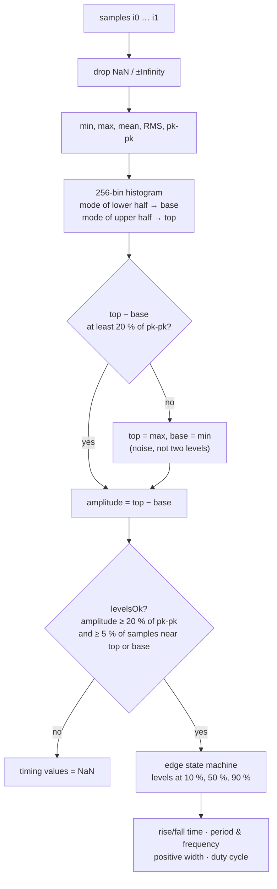

# Analysis: measurements, math channels, FFT

The numeric heart of the app. All of it is plain TypeScript without React or DOM, in
[`src/dsp/`](../src/dsp) and [`src/math/`](../src/math), and runs both on the page and in the compute worker.
The user-facing explanation of each measurement is in the app's *Reference* panel; this page explains
the **algorithms**.

## Measurements

Files: [`dsp/measure.ts`](../src/dsp/measure.ts) (algorithms), [`dsp/measureDefs.ts`](../src/dsp/measureDefs.ts)
(names, units, documentation text), [`dsp/edges.ts`](../src/dsp/edges.ts) (edge finding for snapping).

`measure(data, i0, i1, t0, dt)` returns a `Measurements` object for the samples `[i0, i1)`. The 14
values users can put in the table (`MeasurementKey`):

| Group | Keys |
| --- | --- |
| Amplitude | `max`, `min`, `pkpk`, `mean`, `rms`, `top`, `base`, `amplitude` |
| Timing | `frequency`, `period`, `riseTime`, `fallTime`, `posWidth`, `duty` |

Plus `count` (samples in range) and `levelsOk` (see below), which are not columns.

### The algorithm



Key choices, with their constants:

- **Top and base are histogram modes**, as on Tektronix scopes: a 256-bin histogram, the highest bin of
  the lower half is *base*, of the upper half is *top*. A mode is trusted only if it holds more than 2 %
  of the samples; otherwise max/min are used. So overshoot and ringing do not move the reference levels.
- **`levelsOk` protects timing values.** `MIN_LEVEL_RATIO = 0.2` (amplitude vs pk-pk) and
  `MIN_LEVEL_OCCUPANCY = 0.05` (a sine has ~40 % of its samples near the extremes, a ramp ~20 %, noise <
  2 %). If the signal has no clear two levels – noise, a flat line, a ramp – rise time, frequency and the
  others are `NaN` rather than nonsense. `missingReason()` turns this into the tooltip on a "—" cell.
- **Edges use hysteresis.** The state machine is `unknown → low/high`. A rising edge counts only after
  the signal went from below 10 % to above 90 %; its *time* is the last 50 % crossing. Noise around one
  level cannot create false edges. Crossing times are **linearly interpolated** between samples
  (`crossTime`), so timing is better than one sample interval.
- **What each timing value means:** `riseTime` / `fallTime` = 10–90 % of the *first* rising / falling
  edge; `period` = mean spacing of rising edges (needs ≥ 2 edges); `frequency = 1 / period`; `posWidth` =
  first rising 50 % to the next falling 50 %; `duty = posWidth / period`.
- **Measurement range** is a user choice (`MeasureRange`): the samples `screen`, between `cursors`, or
  the whole `record`. `sampleRange()` in `model/view.ts` converts a range to fractional sample indices.

### Edge snapping

`dsp/edges.ts` supports placing markers and region edges "on the edge". `edgeLevels` /
`levelsOf(measurements)` give the 10/50/90 % levels; `nearestEdge(data, x, maxN, levels, lim0, lim1)`
scans at most `maxN` samples around a fractional index `x` for a 50 % crossing that belongs to a **full
edge** (`isFullEdge` walks outwards through the band between 10 % and 90 % and requires the signal to
reach the other level). The plot uses the measurements of the visible range for the levels (so snapping
needs no extra pass) and an 8 px snap distance.

## The math-channel language

File: [`math/expr.ts`](../src/math/expr.ts). A small, hand-written expression language: tokenizer →
recursive-descent parser → AST → evaluator. No `eval`.

```
CH1 - CH2          CH1 * CH3          integ(CH1 * CH3)       deriv(lowpass(CH2, 1M))
rms(CH1, 20m)      20 * log10(CH2 / CH1)                     CH1 - delay(CH2, 15n)
```

### Grammar and lexical rules

```
expr   := term   (('+' | '-') term)*
term   := unary  (('*' | '/') unary)*
unary  := ('-' | '+') unary | power
power  := primary ('^' unary)?                  // right associative, binds tighter than unary minus
primary:= number | identifier | identifier '(' args ')' | '(' expr ')'
```

- Numbers accept SI suffixes `p n u µ m k K M G` (`10k`, `2.5m`, `100u`). **`m` is milli and `M` is
  mega.** A suffix is recognised only when it is not followed by a letter or digit.
- `×`, `÷` and `−` (Unicode) are accepted as operators.
- Identifiers are channel ids, case-insensitive (`ch1` = `CH1`). Reserved: `t` (time of each sample,
  seconds), `pi`, `e`.
- Every AST node keeps its **character position**, so an error can be underlined in the editor.

### Functions

| Function | Meaning |
| --- | --- |
| `abs sqrt exp ln log10 sin cos` | pointwise |
| `min(a, b)`, `max(a, b)` | sample-by-sample |
| `deriv(x)` | central-difference derivative; unit gets `/s` |
| `integ(x)` | running trapezoidal integral from the start; `W` → `J` |
| `avg(x, window)`, `rms(x, window)` | centred moving average / RMS over a window in seconds |
| `lowpass(x, fc)`, `highpass(x, fc)` | 2nd-order Butterworth applied forward and backward (effective order 4, zero phase, no time shift); `fc` must be below half the sample rate |
| `delay(x, seconds)` | shift in time (shifts `t0`) |

The list shown in the *Reference* panel comes from the same table (`FUNCTION_DOCS` is derived from the
implementations), so documentation cannot drift from behaviour.

### Evaluation

`evaluateMath(defs, sources, cache?)` evaluates all math channels:

- **Values** are either a signal (`data`, `t0`, `dt`, `unit`) or a scalar. A purely scalar result becomes
  a flat line on the time base of the first channel the expression mentions (else the first input channel);
  the variable `t` uses that time base too.
- **Dependencies.** Math channels may refer to each other. `run(id)` evaluates referenced math channels
  first (depth-first); a cycle is reported as "Circular reference involving MATH2".
- **Time bases.** A result keeps the time base of its (left) operand. In a binary operation with a
  different time base, the right operand is **resampled onto the left** (`resample`, linear interpolation).
- **Units are derived**: `V × A = W`, `W ÷ V = A`, `V ÷ A = Ω`, `x²`, `a·b`, `a/b`, `deriv` → `a/s`, `integ`
  → `a·s`. The user can override the unit per math channel (`MathDef.unit`).
- **Errors never throw out.** Every failure becomes `{ error, errorPos }` for that channel; other channels
  still compute, and a channel depending on a failed one reports "MATH1 has an error".
- **Caching.** With a `cache` map (kept by the compute worker), a channel whose expression *and* input
  arrays (same objects, `t0`, `dt`, unit) are unchanged returns the **same sample array**. That identity is
  what lets downstream caches (pyramids, measurements, spectra – all keyed by array) survive edits to
  *other* channels, and changing only a unit creates a new `Waveform` over the same samples.
- `checkSyntax(src, known)` (the set of known channel ids) validates without evaluating, for live feedback while typing.

### Signal building blocks – [`math/signal.ts`](../src/math/signal.ts)

`derivative`, `integral`, `movingAverage`, `movingRms`, `butterworth`, `sampleAt` (interpolated value at a
time, `NaN` outside the record), `resample`. One rule is documented at the top: **invalid samples stay
gaps in running functions and never spread** – one `NaN` must not turn the rest of a running sum into `NaN`.

## FFT and spectra

File: [`math/fft.ts`](../src/math/fft.ts); drawing in [`render/spectrum.ts`](../src/render/spectrum.ts); model
in [`model/spectrum.ts`](../src/model/spectrum.ts).

### Computing a spectrum

`computeSpectrum(data, i0, i1, dt, window, maxN = 2²⁰)`:

1. Fewer than 16 samples → `undefined`.
2. **Decimate** if the range is longer than `maxN`: average consecutive blocks of `decimation =
   ceil(samples / maxN)` samples (like Hi-Res acquisition). This lowers the sample rate and the highest
   frequency shown.
3. Multiply by the **window** and **zero-pad** to the next power of two.
4. FFT of the real signal via `realFftMagnitude`: one **complex FFT of half the length** (even samples as
   the real part, odd as the imaginary part), then split into the real spectrum. The FFT itself is an
   iterative radix-2 decimation-in-time with cached twiddle and bit-reversal tables (a handful of recent sizes are kept, since zooming reuses them).
5. **Scale** so a sine of amplitude *A* reads *A/√2* (its RMS) whatever the window; DC and Nyquist bins
   have no √2 factor. Invalid samples count as 0.

The `Spectrum` result: `rms` per bin, `df`, `n`, `samples`, `used`, `decimation`, `sampleRate`, and `rbw`
(resolution bandwidth = the window's equivalent noise bandwidth × sample rate / `used`, the number of
samples that went into the FFT).

### Windows

Five windows are defined as **cosine sums** in `WINDOW_DEFS`: Rectangular, Hann (default), Hamming,
Blackman-Harris, Flat-top. Each carries its documented properties – equivalent noise bandwidth, worst-case
scalloping loss, highest side lobe, main-lobe width – which `fft.test.ts` checks against the coefficients.
The Reference panel displays them, and `findPeaks` uses them.

### Peak search

`findPeaks(spectrum, count, k0, k1)` returns the highest peaks in a bin range. A candidate is a local
maximum that:

1. stands **≥ 16 dB above the noise** around it (`noiseLevels`), so noise wiggles and falling noise
   floors are not listed;
2. rises above the **main lobe and side lobes** of every higher peak and of the DC level (`leakage`), so
   the window's own leakage is not listed;
3. is at least 4 resolution bandwidths (`PEAK_MIN_SEPARATION`) away from a higher peak, so a tone with
   jitter is one peak.

The frequency is refined with a **parabola through the dB levels of the three bins** around the maximum,
and the level by undoing the window's response at that offset (`windowGain`, the scalloping loss).

### Levels

`toDb(rms) = 20·log10(rms)`: dBV for volts, dB(A) for amps, etc. (`levelUnit`). The spectrum view can show
linear RMS instead; each spectrum uses the unit of its own channel.
