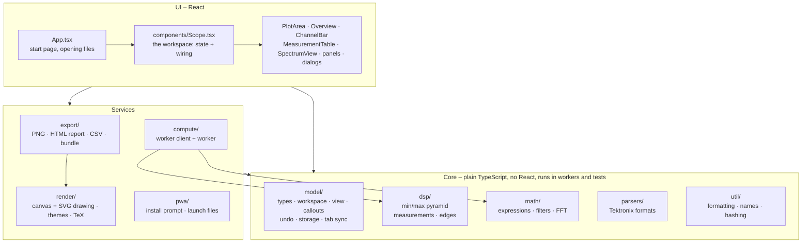
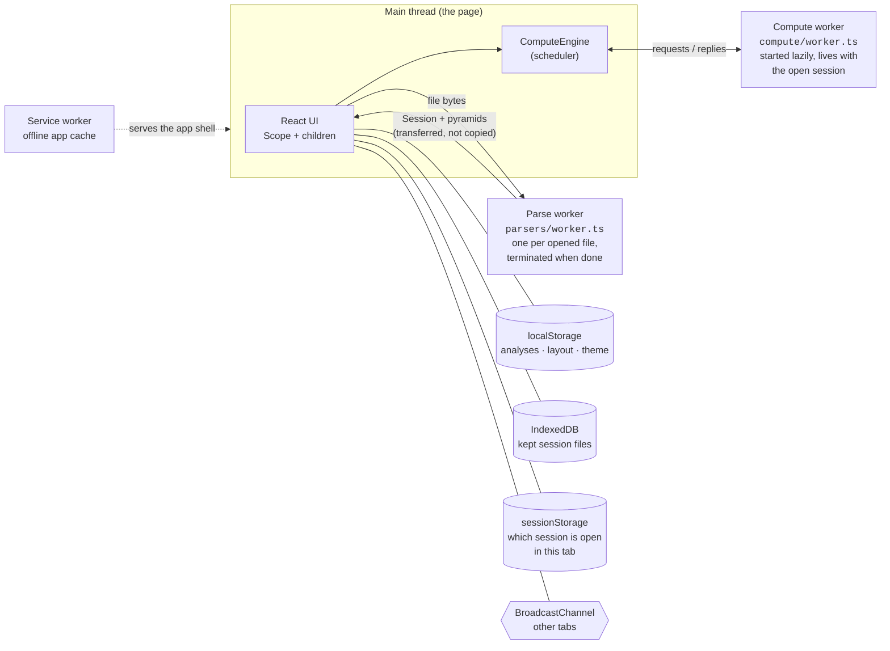
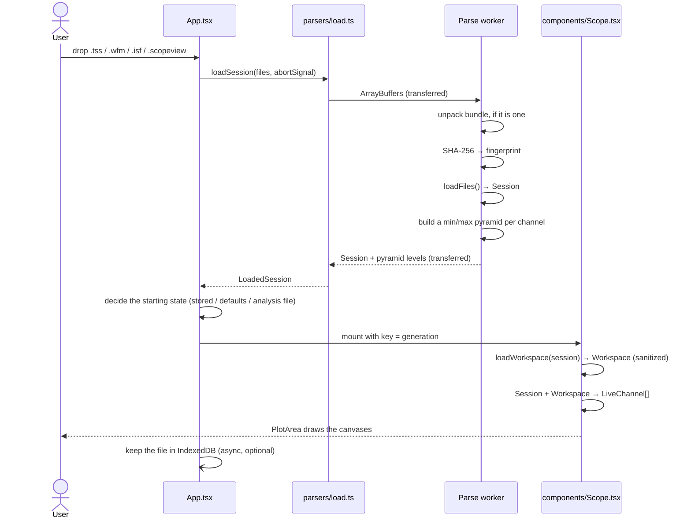
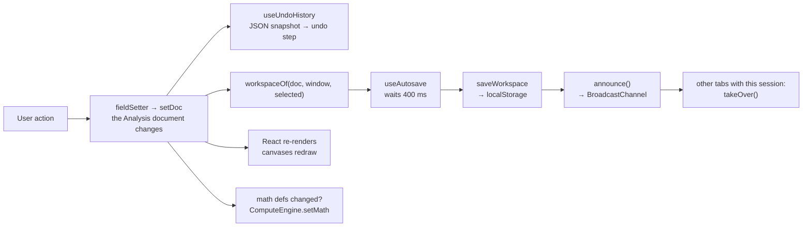

# Architecture

This is the document to read first. It answers four questions: what the app is made of, how the
parts depend on each other, where code runs, and why it was built this way.

## 1. What it is

Scope Viewer is a **single-page application with no backend**. A static bundle (HTML, JavaScript,
CSS) is served by nginx; after that, the browser does all the work. Session files are read from the
user's disk, parsed in a Web Worker, drawn on canvases, and the user's work is saved to browser
storage. The server's Content-Security-Policy forbids connections to any other origin
(`connect-src 'self'`, see [`nginx.conf`](../nginx.conf)), so "your files never leave your computer"
is enforced, not just promised.

| Concern | Choice |
| --- | --- |
| UI | React 19 function components and hooks, TypeScript (strict, `erasableSyntaxOnly`) |
| Build | Vite 8, `vite-plugin-pwa` (Workbox) |
| Drawing | Canvas 2D for waveforms, grid, spectrum; SVG for callouts |
| Background work | Two Web Workers: file parsing, and computation (math, spectra, long measurements) |
| Persistence | `localStorage` (analyses, settings), IndexedDB (kept session files), `BroadcastChannel` (tab sync) |
| Libraries | `fflate` (zip), `lucide-react` (icons), `@mathjax/src` (TeX in callouts, loaded on demand), `workbox-window` |
| Tests | Vitest, plain unit tests (no DOM, no component tests) |
| State management | None added: React state in one composition root, plus plain classes where state outlives React |

There is no router, no state library, no CSS framework and no network code. One global stylesheet
([`src/styles.css`](../src/styles.css)) defines CSS custom properties for the light and dark themes.

## 2. The layers

The code is organised in folders under `src/`. They form layers; arrows below mean "may import from".

### The dependency rules

1. **Only `App.tsx` and `src/components/` import from `src/components/`.** Parsing, analysis, rendering
   and exporting never import UI components. This is true today (checked with a search) and is what
   keeps the core testable without a browser.
2. **Exports reach the plot and the spectrum through two small interfaces**, `PlotImageSource` and
   `SpectrumSource`, declared in [`src/export/sessionExport.ts`](../src/export/sessionExport.ts) and
   implemented by `PlotArea` and `SpectrumView`. The export code does not know those components exist.
3. **React appears outside `components/` in only a few places:** `render/callouts.tsx` (callout
   shapes are React elements, so the screen and the exported SVG share them), `render/tex.ts`,
   `util/usePersistentState.ts` and `pwa/install.ts` (a hook each), `main.tsx`, `App.tsx`.
4. **The layers are conventions, not enforced by tooling.** A few small, deliberate shortcuts exist: the
   parsers import `fitBand` from `model/view` and the constant `DIVS_Y` from `render/draw` to give
   files without a V/div setting a sensible autoscale; `dsp/measureDefs` imports a type from
   `model/view`. Keep such links to constants, types and pure functions.

### What each layer is for

| Folder | Responsibility | Typical file |
| --- | --- | --- |
| `parsers/` | Bytes → `Session`. Knows Tektronix file layouts and SCPI setup files. | `session.ts`, `tekWfm.ts` |
| `dsp/` | Numeric analysis of sample arrays: the min/max pyramid, automatic measurements, edge finding. | `measure.ts`, `minmax.ts` |
| `math/` | The math-channel language, filters, and the FFT with windows and peak search. | `expr.ts`, `fft.ts` |
| `model/` | What the app *means*: data types, the workspace document, view/zoom helpers, callouts, undo history, browser storage, tab sync. | `workspace.ts`, `view.ts` |
| `compute/` | Moves math, spectra and long measurements off the page into a worker. | `engine.ts`, `core.ts` |
| `render/` | Pure drawing: canvas functions, geometry, themes, callout layout, TeX. | `draw.ts`, `callouts.tsx` |
| `export/` | Turns the current state into files. | `sessionExport.ts` |
| `components/` | React UI and the hooks that connect it to the model. | `Scope.tsx`, `PlotArea.tsx` |
| `pwa/` | Install prompt and "open with" file launches. | `install.ts` |
| `util/` | Small helpers with no domain knowledge (SI formatting, names, SHA-256, caches). | `format.ts` |

## 3. Where code runs

Two ideas to hold on to:

- **The page stays light.** Anything that scales with the length of the record (parsing, building the
  pyramid, evaluating math, FFT of a million samples, measuring a whole record) happens in a worker.
  The page only does work that scales with the number of *pixels*.
- **Big arrays are moved, not copied.** `Float32Array` buffers are *transferred* between page and
  worker, and each array crosses the boundary at most once. Afterwards both sides refer to it by a
  short name ("ref"). See [Workers and compute](workers-and-compute.md).

## 4. The life of a file

What happens between dropping a file and seeing a waveform:

Details worth knowing:

- Opening another file while one is loading **aborts** the first (`AbortController` in `App.open`);
  the latest file wins.
- `Scope` is remounted for every new file, imported analysis or reset: `App` bumps `generation`, which is
  the React `key` of the `ErrorBoundary` around `Scope`. The workspace therefore never has to be "reset"
  in place; a fresh component starts from `InitialState`.
- The workspace is *built from two inputs*: the immutable `Session` (what the file says) and the
  saved `Workspace` (what the user changed). See [Data model](data-model.md).

## 5. The life of an edit

What happens when the user changes anything about the analysis – drags a channel tag, adds a note,
edits a math expression:

The important property is that **one serialisable document** (`Analysis`) drives undo, autosave,
analysis files, bundles and multi-tab sync. Add a field to it and all five work, with no extra code.
See [State and persistence](state-and-persistence.md).

## 6. Key design decisions

| Decision | Why | Where |
| --- | --- | --- |
| **Samples are `Float32Array` in physical units**, converted once at parse time | Half the memory of `Float64Array` for million-sample records; no per-frame scaling | [`parsers/`](../src/parsers), [`model/types.ts`](../src/model/types.ts) |
| **Min/max pyramid** per channel | One pixel column can span millions of samples; the pyramid answers "min and max of samples i0…i1" with a handful of lookups, so drawing cost depends on the screen, not the record | [`dsp/minmax.ts`](../src/dsp/minmax.ts) |
| **Parsing and pyramid building in a worker** | A 100 MB record would freeze the page for seconds | [`parsers/worker.ts`](../src/parsers/worker.ts) |
| **One compute worker, one request at a time, latest wins** | While panning, hundreds of "measure this range" requests would pile up; only the newest per consumer matters | [`compute/engine.ts`](../src/compute/engine.ts) |
| **A single `Workspace` JSON document, sanitised on load** | Autosave, undo, files, bundles and tab sync all share it; unknown or broken data falls back to file defaults, so a bad file or old save cannot break the viewer | [`model/workspace.ts`](../src/model/workspace.ts) |
| **Sessions are identified by the SHA-256 of their contents**, not their name | Renaming a file keeps your work; two different files with the same name do not collide | [`parsers/worker.ts`](../src/parsers/worker.ts) |
| **Callouts are stored in data coordinates** (time, channel value) | They stay attached to the waveform when you zoom, pan or change V/div | [`model/callouts.ts`](../src/model/callouts.ts) |
| **Canvas for traces, SVG for callouts** | Traces need raw speed; callouts need hit-testing, text layout and crisp vector output in exports | [`render/`](../src/render) |
| **Screen and exports use the same drawing functions** | An exported image is exactly what is on screen, only larger and optionally in the light theme | `PlotArea.renderImage` |
| **Each command is one `Action`**, offered by the toolbar, menus, palette and keyboard | The four can never disagree on label, icon, shortcut or enabled state | [`components/ui/action.ts`](../src/components/ui/action.ts) |
| **Theme colours exist twice** (CSS tokens and a TypeScript `Theme`), and a test compares them | Canvases and exports need concrete colours in code; the page needs CSS variables | [`render/themeSync.test.ts`](../src/render/themeSync.test.ts) |
| **The service worker asks before updating** (`registerType: 'prompt'`) | The app never changes under the user's hands; because work is autosaved, reloading loses nothing | [`vite.config.ts`](../vite.config.ts), [`PwaStatus.tsx`](../src/components/PwaStatus.tsx) |
| **MathJax is loaded on demand** and its big glyph tables are kept out of the offline precache | ~1.4 MB core and ~10 MB of rare glyphs would otherwise slow the first load | [`render/mathjax.ts`](../src/render/mathjax.ts), `vite.config.ts` |

## 7. Where complexity lives

Three files hold most of the integration logic; knowing them makes the rest easy to navigate:

- [`components/Scope.tsx`](../src/components/Scope.tsx) (~1000 lines) – the **composition root of the
  workspace**. It owns the `Analysis` document, navigation, undo, autosave and tab sync (via hooks),
  defines all `Action`s, and passes props down. Nothing below it owns analysis state.
- [`components/PlotArea.tsx`](../src/components/PlotArea.tsx) (~1100 lines) – the interactive plot:
  pointer handling for every tool, drawing orchestration, callout layer, image rendering for exports.
- [`model/workspace.ts`](../src/model/workspace.ts) – defaults from a file, sanitising untrusted
  input, and the storage format.

Everything else is small and single-purpose. The [Module map](module-map.md) lists them all.
