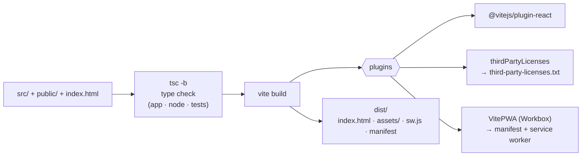

# Build, PWA and deployment

How the app is built, how it becomes an installable offline app, and how it is shipped.

## 1. Build pipeline



Scripts ([`package.json`](../package.json)):

| Script | Does |
| --- | --- |
| `npm run dev` | Vite dev server on `http://localhost:5173` |
| `npm run build` | `tsc -b && vite build` → `dist/` |
| `npm run preview` | serve `dist/` on `http://localhost:4173` — needed to test the service worker and offline mode |
| `npm run typecheck` | `tsc -b` |
| `npm run lint` | `oxlint` |
| `npm test` | `vitest run` |
| `npm run check` | `tsc -b && oxlint && vitest run` – what CI runs before building |

### TypeScript projects

[`tsconfig.json`](../tsconfig.json) only references three projects:

| Project | Covers | Notes |
| --- | --- | --- |
| `tsconfig.app.json` | `src/` except tests | `lib: ES2023 + DOM`, `jsx: react-jsx`, bundler resolution |
| `tsconfig.test.json` | `src/**/*.test.ts`, `globals.d.ts` | extends the app config, adds `node` types (tests read files) |
| `tsconfig.node.json` | `vite.config.ts`, `tools/` | `nodenext`, no DOM |

Shared strictness: `noUnusedLocals`, `noUnusedParameters`, `noFallthroughCasesInSwitch`,
`erasableSyntaxOnly` (no `enum`, no parameter properties, no namespaces – everything must be removable by
stripping types), `verbatimModuleSyntax` (use `import type`), `allowImportingTsExtensions` (imports may end in
`.ts`).

### Build-time constants

`vite.config.ts` defines two globals, declared in [`src/globals.d.ts`](../src/globals.d.ts):

- `__APP_VERSION__` – from `package.json`; written into analysis files and reports and shown in the help.
- `__BUILD_TIME__` – ISO timestamp of the build.

### Chunks

- **MathJax** (TeX in callouts, ~1.4 MB) is its own chunk, loaded by a dynamic `import()` only when a
  callout contains a formula. `chunkSizeWarningLimit` is raised to 1500 kB for it.
- **MathJax glyph tables** for rare characters (~10 MB in ~40 files) are routed to `assets/mathjax-fonts/`
  by `chunkFileNames`, so the service worker can leave exactly that folder out of the offline precache.
- Both web workers are bundled by Vite from `new Worker(new URL('./worker.ts', import.meta.url), { type: 'module' })`.

### Third-party licences

[`tools/thirdPartyLicenses.ts`](../tools/thirdPartyLicenses.ts) is a small Vite plugin. Minification drops
licence comments, and MIT/ISC/Apache-2.0 all ask for the notice to travel with the code, so on build it
reads the licence files of every npm package that ends up in the bundle (plus the Workbox runtime, which
sits in the service worker, and `NOTES` for packages with an incomplete licence story such as the MathJax
font) and writes `third-party-licenses.txt` next to `index.html`. The start page and help popover link to it.

## 2. The installable app (PWA)

Configured in [`vite.config.ts`](../vite.config.ts) with `vite-plugin-pwa`.

| Feature | How |
| --- | --- |
| **Manifest** | name, icons (64/192/512 + maskable), `display: standalone`, `start_url: '/'`, colours from `PAGE_COLORS` (shared with the CSS) |
| **Open with…** | `file_handlers` for `.tss`, `.wfm`, `.isf`, `.scopeview`. When launched with files, the browser fills `window.launchQueue`; [`pwa/launch.ts`](../src/pwa/launch.ts) forwards them to `App.open`. A launched file wins over "restore the previous session". Chromium on desktop only. |
| **Install button** | [`pwa/install.ts`](../src/pwa/install.ts) captures `beforeinstallprompt` as early as possible (`main.tsx`, before React renders), prevents the browser's own banner and offers *Install* from the start page and File menu (`useCanInstall`). |
| **Offline** | Workbox precaches `**/*.{html,js,css,svg,ico,txt}` and the Apple icon, except the MathJax glyph folder; files up to 3 MB. `navigateFallback: 'index.html'`. Glyph tables are cached at runtime (`CacheFirst`, `assets` cache, 120 entries) the first time a formula needs them. |
| **Updates** | `registerType: 'prompt'`: a new service worker waits. [`PwaStatus`](../src/components/PwaStatus.tsx) shows "A new version is available. Your work is saved." with a *Reload* button, and checks for updates hourly. `cleanupOutdatedCaches: true`. |
| **Icons** | Generated from `public/favicon.svg` with `npx pwa-assets-generator` (config in [`pwa-assets.config.ts`](../pwa-assets.config.ts)); the PNGs are committed. |

Installation and offline use need **HTTPS** or `localhost`. Over plain HTTP the app is an ordinary web page
(SHA-256 and clipboard code have fallbacks for exactly this reason: `util/sha256.ts`, `util/clipboard.ts`).

> **Testing the service worker:** it is not active under `npm run dev`. Use `npm run build && npm run preview`
> and open `http://localhost:4173`. To start from a clean slate use DevTools → Application → Storage →
> *Clear site data*.

## 3. Continuous integration

[`.github/workflows/ci.yml`](../.github/workflows/ci.yml) runs on every push to `main` and every pull
request, on `ubuntu-latest` with **Node 24** (the same major as the Docker build stage):

1. `npm ci`
2. `npm run lint`
3. `npm test`
4. `npm run build` (this includes the full type check)

The session-file tests (see [Development](development.md#2-tests)) are skipped in CI because the sample file
is not committed.

## 4. Docker and nginx

[`Dockerfile`](../Dockerfile) is multi-stage:

```
node:24-alpine   ──  npm ci · npm run build          →  /app/dist
nginx:1.27-alpine ──  nginx.conf + dist               →  port 80, with a health check
```

[`nginx.conf`](../nginx.conf) is small but deliberate:

| Setting | Why |
| --- | --- |
| `gzip` for CSS/JS/JSON/SVG over 1 KB | smaller transfer |
| `location /assets/ { expires max; }` | build assets have content hashes in their names, so they never change |
| `location / { expires -1; try_files … /index.html; }` | `index.html` and `sw.js` must never be cached stale; unknown paths fall back to the app |
| `Content-Security-Policy: default-src 'self'; img-src 'self' blob: data:; style-src 'self' 'unsafe-inline'; worker-src 'self' blob:; connect-src 'self'` | **No other origin can be contacted** — the technical guarantee that files are not uploaded. No inline scripts (hence `public/theme-init.js`). `blob:` for session screenshots and workers, `data:` for the report image. |
| `X-Content-Type-Options: nosniff`, `Referrer-Policy: no-referrer` | hardening |

A subtle nginx rule is written down in the config: `add_header` in a `location` *replaces* inherited
headers, which is why caching is done with `expires` rather than a `Cache-Control` header there.

### Coolify

Create an application from the repository with the **Dockerfile** build pack and set the exposed port to
`80`. No environment variables are needed; there is no backend.

## 5. Browser support

The code relies on current evergreen features: module workers and transferable buffers, `BroadcastChannel`,
IndexedDB, `AbortSignal.throwIfAborted`, `Array.prototype.findLast`, and (when present) `navigator.storage.estimate`.
Installation and file handling are Chromium features; Firefox and Safari run the app as a normal web page,
and iOS can use *Add to Home Screen*.
