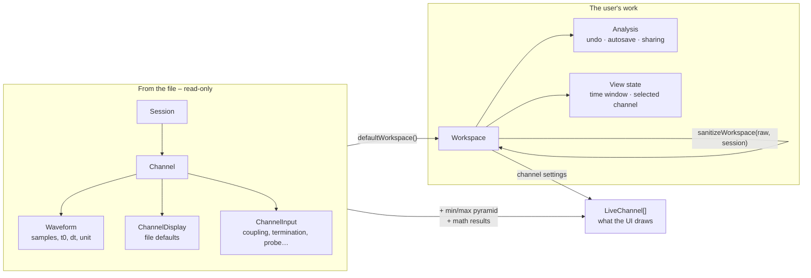

# Data model

Everything in the app is built from a small number of types. This page defines them, shows how they
relate, and explains the coordinate systems used on the screen. Other documents use these words.

## 1. Two worlds: the file and the user's work

The central idea is a strict separation:

- **`Session`** – *what the file says.* Waveforms, channel names, the scope's V/div, trigger, cursors,
  screenshot. Built once when a file is opened. **Never modified afterwards.**
- **`Workspace`** – *what the user did.* Channel colours and labels, math channels, spectra,
  callouts, cursors, zoom, notes. Saved in the browser and in analysis files.

When a file is opened for the first time, the workspace is simply derived from the session
(`defaultWorkspace(session)`: "everything as set on the scope"). Later, the saved workspace is loaded
and validated against the session (`sanitizeWorkspace`). The user can always **reset to file
defaults**.



## 2. The types

### From the file – [`src/model/types.ts`](../src/model/types.ts)

| Type | Meaning |
| --- | --- |
| `Waveform` | One analog waveform: `id` (e.g. `"CH1"`), `data: Float32Array` already in physical units, `t0` (time of the first sample, seconds, relative to the trigger), `dt` (sample interval, s), `yUnit`, `xUnit`. Sample *i* is at time `t0 + i·dt`. |
| `ChannelDisplay` | How a channel is shown: `label`, `color`, `visible`, `scale` (V/div), `position` (divisions from the centre), `offset` (units subtracted before scaling). |
| `ChannelInput` | How a channel was connected on the scope: `coupling`, `termination`, `bandwidth`, probe `attenuation`, `extAttenuation`, `probeMode`, `probeDelay`, `ampsPerVolt`, `invert`, `deskew`. Every field is optional – only what the files contain. Read-only information. |
| `Channel` | `{ wave, display, input? }` |
| `Session` | `fileName`, `fingerprint` (SHA-256 of the file contents), `format` (display name), `channels`, `views` (channel ids grouped per stacked view, top to bottom), and optional `horizontal` (time base when saved), `trigger`, `cursors`, `measurements` (switched on in the setup), `screenshot`, `setup` (raw SCPI key/values), `timestamp`, `warnings` (files that could not be read). |

### The user's work – [`src/model/workspace.ts`](../src/model/workspace.ts)

```ts
interface Workspace {
  version: 1
  channels: ChannelDisplay[]      // every channel incl. math: current settings
  views: string[][]               // channel ids per stacked view
  viewSizes?: number[]            // share of the plot height per view (sums to 1)
  math: MathDef[]                 // { id: "MATH1", expr: "CH1 - CH2", unit? }
  spectra: SpectrumDef[]          // { id: "FFT1", source: "CH1", window, visible }
  spectrumOptions: SpectrumOptions // range, dB/linear, log/linear axis, peak count
  callouts: Callout[]
  cursors: CursorState            // { on, a, b, source }
  window: TimeWindow              // the zoom: { start, end } in seconds
  measurements: { keys, range, exclude }
  selected?: string               // selected channel
  notes: string                   // free text used in reports
}

type Analysis = Omit<Workspace, 'version' | 'window' | 'selected'>
```

**`Analysis` is the workspace minus the *view* on it** (the time window and the selected channel).
This split matters:

| | Part of `Analysis` | Not part of it |
| --- | --- | --- |
| Examples | channel settings, math, spectra, callouts, cursors, measurement choice, notes | zoom window, selected channel, which panels are open |
| Undo / redo | yes | no – zooming is navigation; use **Back** (Backspace) |
| Shared with other tabs | yes | no – each tab keeps its own view |
| Saved in an analysis file | yes | yes (the window and selection are stored, but are not undo steps) |

### Derived at runtime – [`src/model/view.ts`](../src/model/view.ts)

`LiveChannel` is a `Channel` plus its `MinMaxPyramid`. `Scope` builds the list of live channels from:

- the session's input channels, with the *current* `ChannelDisplay` from the workspace, and
- every math channel whose expression was evaluated successfully (its waveform and pyramid come
  from the compute worker).

This list (`channels` in `Scope.tsx`) is what the plot, overview, measurement table, spectrum view
and exports consume. A channel whose math expression has an error has settings but **no** live channel.

## 3. Identifiers

| Kind | Form | Rules |
| --- | --- | --- |
| Input channel | `CH1`, `CH2`, … also `MATH1`, `REF1` from files | Derived from the file name (`ch1.wfm`, `Tek000_CH1.wfm`) or, for `.isf`, from the waveform id inside the file. Unique within a session. |
| Math channel | `MATH1` … `MATH8` | Must match `^MATH\d+$`. `nextMathId` skips ids already used by the file itself (a scope may save its own `math1.wfm`). |
| Spectrum | `FFT1` … `FFT8` | `nextSpectrumId` |
| Callout | random id plus a running number `n` | `newCalloutId`, `nextCalloutNumber`; `n` is shown when the callout has no text |
| Session | 64-hex SHA-256 | For several files: hash of the sorted hashes. For a `.scopeview` bundle: hash of the files *inside* it, so a bundle shares the saved state of its session file. |

Channel ids are case-insensitive in math expressions (they are upper-cased when referenced) and are
rendered for humans by `channelName` (`CH1` → "Ch 1") in [`src/util/names.ts`](../src/util/names.ts).

## 4. Coordinates and units

Getting these straight makes the drawing code readable.

### Time (horizontal)

- Time is in **seconds**, with 0 at the trigger. A record might run from −5 ms to +15 ms.
- `TimeWindow { start, end }` is what the plot shows. Pixel `x` maps linearly:
  `t = start + (x / plotW) · (end − start)`.
- `plotW` is the width of the plot **minus a 64 px gutter** on the right (`AXIS_GUTTER`) that holds
  the vertical scale labels.
- Zoom limits (`spanLimits`): at least **10 samples** of the fastest channel on screen, at most
  **4 ×** the record. Panning and zooming stop at the ends of the record (`keepInRecord`) unless a
  caller explicitly asks to go beyond it (a callout placed off the record, the "saved view").

### Value (vertical)

Each view is always **10 divisions high** (`DIVS_Y = 10`), like a scope screen. A channel is
placed with three numbers:

```
div     = (value − offset) / scale + position
screenY = viewHeight / 2 − div · (viewHeight / 10)
```

| Setting | Unit | Meaning |
| --- | --- | --- |
| `scale` | value per division (V/div) | Vertical zoom. Steps follow the 1-2-5 sequence (`stepScale`). |
| `position` | divisions | Where the channel's *offset level* sits relative to the view's centre. This is what the channel tag on the left edge marks. |
| `offset` | channel unit | The value that appears at `position`. Often 0. |

The inverse is `divToValue`. Both live in [`src/render/draw.ts`](../src/render/draw.ts).

### Callouts – data coordinates

A callout stores **time** (`t`, `t2`) and, when attached to a trace, a **channel value** (`v`, `v2`)
plus the channel id. Free notes that are not on a trace store a *view index and division* (`view`,
`div`) instead. Because screen positions are recomputed on every draw (`layoutCallouts`), callouts
follow the waveform through any zoom, pan, V/div or position change. Only pixel offsets of text
boxes (`dx`, `dy`) are stored in screen units.

## 5. Validation: never trust stored data

Everything that comes from outside the running code – `localStorage`, an analysis file, a bundle –
passes through **`sanitizeWorkspace(raw, session)`** before use. It rebuilds a valid workspace field by
field, falling back to the file defaults for anything missing or wrong:

- every channel of the session gets display settings; stored values override defaults one field at a
  time, after checks (finite numbers, `scale > 0`, colour must look like `#rrggbb`, label ≤ 100 chars);
- math channels must have an id matching `MATH<n>`, no duplicates, no clash with a file channel;
  expressions are cut at 2,000 characters;
- views keep only known ids, each id once; channels missing from every view are added (inputs join
  the last view, math channels get their own);
- `viewSizes` is accepted only if there is exactly one finite positive number per view;
- spectra are kept only if their source channel exists; callouts go through `sanitizeCallouts`;
- the time window is clamped to the zoom limits and rejected if it lies absurdly far from the record;
- notes are cut at 20,000 characters.

The result: a corrupted save, an analysis file made for another file, or data from an older version
can lose some details but cannot crash the viewer. As a last resort, `ErrorBoundary` offers to discard
the saved state.

## 6. Limits at a glance

| Limit | Value | Constant |
| --- | --- | --- |
| Math channels | 8 | `MAX_MATH` |
| Spectra | 8 | `MAX_SPECTRA` |
| FFT length | 2²⁰ samples (longer ranges are block-averaged first) | `MAX_FFT` |
| Fewest samples for a spectrum | 16 | `MIN_FFT_SAMPLES` |
| Undo steps kept | 200 | `UndoHistory` constructor |
| "Back" view history | 50 | `useNavigation` |
| Analyses remembered in the browser | 50 sessions | `MAX_STORED_SESSIONS` |
| Session file kept in IndexedDB | 300 MB each, 1 GB total, and at most 40 % of the browser's quota | `fileStore.ts` |
| Shortest view | 40 px | `MIN_VIEW_H` |
| Measured on the page instead of the worker | ranges up to 50,000 samples | `PAGE_MEASURE_MAX` |
