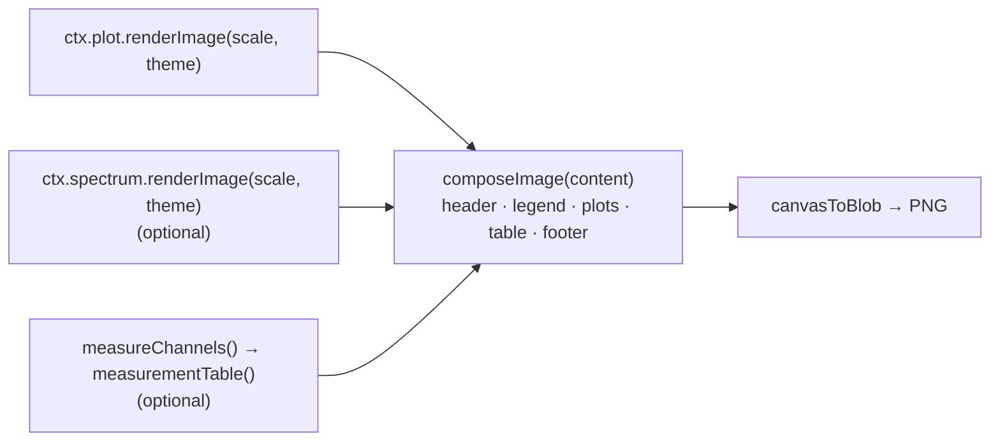

# Exports

All outputs of the **Export** menu and the **File → Save** commands. Code: [`src/export/`](../src/export),
[`components/ExportDialog.tsx`](../src/components/ExportDialog.tsx).

| Output | Built by | File |
| --- | --- | --- |
| Image | `renderImage` → `composeImage` → `canvasToBlob` | `<name>.png` (or copied to the clipboard on HTTPS) |
| Report | `reportTables` + `buildReport` | `<name>-report.html` (one self-contained file, printable to PDF) |
| Waveform data | `buildWaveformCsv` | `<name>-<range>.csv` |
| Measurements | `buildMeasurementsCsv` | `<name>-measurements.csv` |
| Spectra | `buildSpectrumCsv` | `<name>-spectra.csv` |
| Analysis | `analysisToJson` (in `model/workspace.ts`) | `<name>.scopeview.json` |
| Bundle | `buildBundle` | `<name>.scopeview` |

## 1. How exports see the app

An export needs a lot of state (channels, window, callouts, measurement choice, …) and two things that
only the UI can do (draw the plot, draw the spectrum). It gets both through a single
**`ExportContext`** that `Scope` builds *when the user exports* (`exportContext()`), not on every render:

```ts
interface ExportContext {
  session, channels /* LiveChannel[] */, math, callouts, cursors,
  win, record, minDt, timePerDiv,
  measKeys, measRange, measExclude,
  spectra, specOptions, notes,
  plot: PlotImageSource | null          // implemented by PlotArea
  spectrum: SpectrumSource | null       // implemented by SpectrumView
}

interface PlotImageSource    { renderImage(scale, theme): Promise<HTMLCanvasElement> }
interface SpectrumSource     { renderImage(scale, theme): HTMLCanvasElement | null; getData(): SpectrumExport }
```

The two interfaces are the **only coupling** between `export/` and the UI. The export code never
imports a component, which keeps it testable and keeps the dependency direction clean (see
[Architecture](architecture.md#the-dependency-rules)).

`runExport(ctx, kind, prefs, { title, copy })` is the single entry point; the dialog calls it and shows
errors as notices.

## 2. Image (PNG)



- `scale` is 1–3× the on-screen CSS size. The plot is **redrawn at that resolution** with the same drawing
  functions as the screen (see [Rendering](rendering.md#7-rendering-for-export)), not upscaled.
- `appearance` (Dark/Light) picks `THEMES[appearance]`; in Light, `theme.ink` darkens pale trace colours to a
  3:1 contrast.
- `composeImage` measures the layout first with a scratch context to know the final height, then draws:
  header (file name + `infoLines`: format, points, sample rate, record, time/div, trigger, cursors), legend
  (colour dot, name, label or math expression, V/div), the plot(s), the measurement table, a footer with the
  date. Every size is in CSS pixels multiplied by `scale`.
- Copy to clipboard (`ClipboardItem`) works only on HTTPS (`canCopyImage` checks `isSecureContext`).

## 3. Report (HTML)

`buildReport` ([`report.ts`](../src/export/report.ts)) returns a **single HTML string**: inline CSS in the
light appearance's colours and fonts, the notes, a metadata table (file, format, record, trigger, shown
window, creation time, **file SHA-256**), the image as a `data:` URL, and tables.

`reportTables(ctx, prefs)` produces the tables in `sessionExport.ts` – *Channels* (with the input
summary when files have it), *Math channels* (with errors), *Measurements*, *Cursors* (value at A, B and
Δ), *Callouts* (sorted by time, with duration, channel and text), *Spectrum peaks* – each switchable in
the dialog.

Points of care:

- All user text goes through `escapeHtml`; callout text goes through `texHtml`, which embeds rendered
  formulas as inline SVG. Because rendering is asynchronous, `runExport` calls `await loadTex(...)` for all
  callout texts first.
- Tables use `ink(color)` of the chosen appearance so colour dots match the image.
- The file is self-contained: the image is embedded as a `data:` URL and the CSS is inline, so it can be
  emailed or archived and printed to PDF from any browser.

## 4. CSV files

[`csv.ts`](../src/export/csv.ts) writes three dialects (`CsvFormat`):

| Key | Separator | Decimal | BOM | For |
| --- | --- | --- | --- | --- |
| `intl` | `,` | `.` | no | general use |
| `excel-de` | `;` | `,` | yes (UTF-8) | Excel with German/European settings; the BOM makes Excel show µ, ä, … |
| `tab` | tab | `.` | no | pasting into spreadsheets |

A small `writer(format)` formats numbers (`toPrecision(7)`, 10 for time; non-finite → empty cell) and
quotes text cells that contain separators, quotes or newlines.

- **Waveform CSV** – rows are samples of the **first channel's time base**; other channels are copied
  directly when their time base is identical and **interpolated** (`valueAt`) otherwise. `step` keeps every
  n-th sample. Rows are built in chunks of 20,000 lines and passed to `Blob` as parts, so very long
  exports do not create one giant string. `waveformRowCount` lets the dialog show the size beforehand.
- **Measurements CSV** – values in base units, one row per measured channel.
- **Spectra CSV** – one column per visible spectrum in dB or linear as shown on screen.

The range for waveform data is chosen in the dialog (`screen`, `cursors`, `record`; `rangeWindow` maps it
to a `TimeWindow`) and for "all channels" includes hidden ones.

## 5. The measurement rows are shared

[`measureRows.ts`](../src/export/measureRows.ts) has the single definition of *which channels appear in
a measurement table*: `measuredChannels` = visible channels not in `exclude`. The on-screen table, the
image, the report and the CSV all use it, so they always list the same channels. (New channels – a math
channel added later – are measured by default because `exclude` is a deny-list.)

Exports measure through `measureChannels`, which calls `measure()` directly on the page. Unlike the live
table they do not use the worker; an export is a deliberate, one-time action.

## 6. Analysis and bundle

Described in [File loading](file-loading.md#4-bundles-and-analysis-files) and
[State and persistence](state-and-persistence.md#8-analysis-files-and-reset). In short: the analysis is the
`Workspace` as JSON with the session's fingerprint; the bundle is a zip of the original files plus that
JSON. *Save session with analysis* needs the **original file bytes**, which `App` keeps as `sources` for
exactly this purpose.
