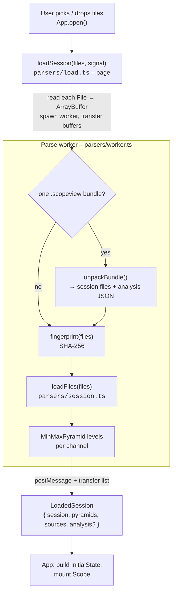
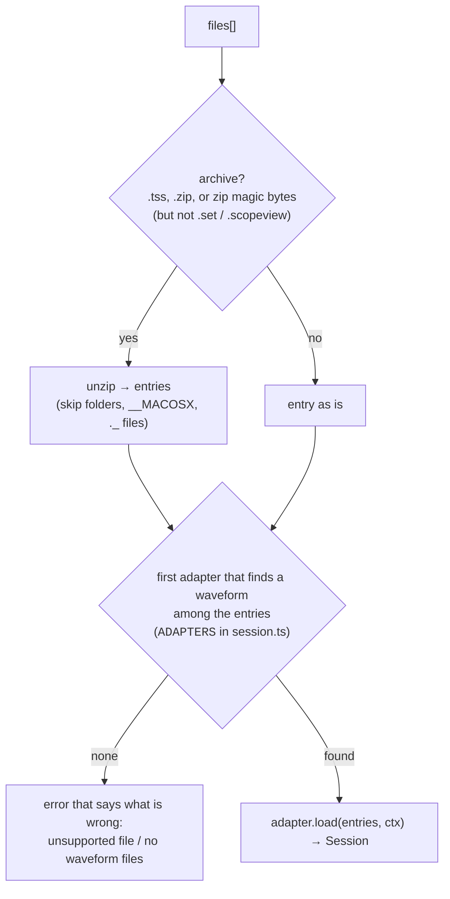
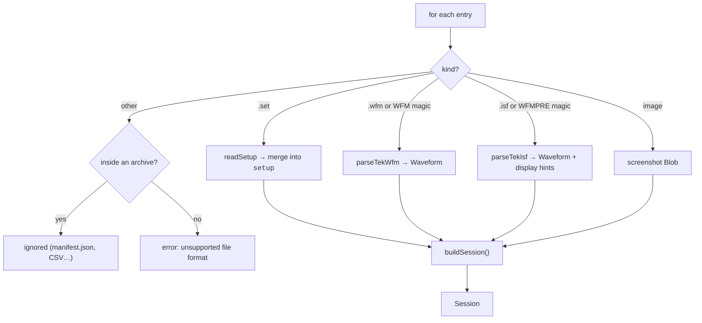

# File loading

How bytes on disk become a `Session`. Code: [`src/parsers/`](../src/parsers), with the bundle format in
[`src/export/bundle.ts`](../src/export/bundle.ts).

## 1. The pipeline



Design points:

- **Everything heavy is in the worker.** The page only reads the files into memory (`File.arrayBuffer()`)
  and hands the buffers over.
- **Cancellation.** `loadSession` takes an `AbortSignal`; aborting rejects with its reason and the
  worker is terminated in a `finally`. `App.open` aborts the previous read whenever a new file is opened.
- **Transfer, not copy.** The result's transfer list contains the sample buffers, the original file
  buffers (kept for saving bundles) and the pyramid levels, de-duplicated.
- **A failing hash never blocks opening.** If `fingerprint()` throws, the file still opens; its
  workspace just cannot be remembered (`session.fingerprint` is `undefined`).
- **Errors are plain messages** (`Error.message`), shown on the start page or as a notice.

## 2. `loadFiles` – turning files into a session

[`loadFiles(files, adapters = ADAPTERS): Session`](../src/parsers/session.ts) is synchronous and has no
browser dependencies, so it is easy to test. It does two things itself – **unpack archives** and
**choose the format** – and leaves the reading to a *format adapter*.



A **`FormatAdapter`** ([`formats.ts`](../src/parsers/formats.ts)) is a small object: `id`,
`waveformExtensions` (for messages), `isWaveform(file)` (by name or content), `recognises(file)`
(a waveform, or what goes with one – a setup, a screenshot) and `load(entries, ctx)`. `ctx` says what
the files came in (`archive`: `'tss'`, `'zip'` or none), the session's name, and a `recognised(file)`
that asks *all* adapters, so a file of another known format is not reported as unsupported. The
shared helpers (`channelIdFromName`, `CHANNEL_COLORS`, `reasonFor`) live there too. Today there is one
adapter, the Tektronix family in [`tektronix.ts`](../src/parsers/tektronix.ts); the tests pass their own
adapters to `loadFiles` to check the dispatch.

The Tektronix adapter reads each entry according to its kind:



### Be forgiving: partial success

A file that cannot be read (an unsupported waveform format, a damaged setup) is **left out and
recorded** in `session.warnings`; the session opens with the others. Only when *no* waveform could be
read does `loadFiles` throw, and the message then names the real reason. `App` shows the warnings as a
notice ("Left out what could not be read: …").

### Channel ids from file names

`channelIdFromName` maps `ch1.wfm`, `Tek000_CH1.wfm` or `tek0000CH1.isf` to `CH1`, and `math1`/`ref2`
likewise. If two files would map to the same id (for example a digital channel `ch1_d0.wfm`), the
second is named after its file (`CH1_D0`); a numeric suffix (`_2`) is added if that is taken as well.
For `.isf` the id inside the file (`"Ch1, DC coupling, …"`) is preferred over the file name.

### `buildSession` – the setup does the talking

When a setup (`.set`) is present, `buildSession` reads display settings from keys of two generations of
instruments (the 4/5/6-Series MSOs, and the older TDS, DPO/MSO2000–4000, MDO3000 families). For each
setting it tries the keys in this order and takes the first that exists:

| What | Keys tried, in order |
| --- | --- |
| Label | `:CHn:LABEL:NAME`, then `:CHn:LABEL` |
| V/div | `:CHn:SCALE`, then `:CHn:VERTICAL:SCALE`, then the `.isf` preamble hint |
| Position | `:CHn:POSITION`, then `:CHn:VERTICAL:POSITION`, then the `.isf` hint |
| Offset | `:CHn:OFFSET`, then the `.isf` hint |
| On/off | `:DISPLAY:WAVEVIEW1:CHn:STATE`, then `:SELECT:CHn` (a saved waveform is shown unless the setup says it was switched off) |
| Stacked views | `:MAINWINDOW:SOURCEORDER`, e.g. `0;ch1,ch6,ch2;ch4,ch5,ch3` (the first token is not a source group), unless `:DISPLAY:WAVEVIEW1:VIEWSTYLE` is `OVERLAY`; channels not listed join the last view |
| Time base | `:HORIZONTAL:SCALE` (else `:HORIZONTAL:MAIN:SCALE`), `:POSITION` (% of the screen where the trigger is), `:SAMPLERATE`, and `:DELAY:TIME` when delay mode is on |
| Trigger | `:TRIGGER:A:EDGE:SOURCE`, `:SLOPE`, level from `:TRIGGER:A:LEVEL:<source>` (else `:TRIGGER:A:LEVEL`) |
| Cursors | `:DISPLAY:WAVEVIEW1:CURSOR:CURSOR:*` when enabled, else the vertical bars `:CURSOR:VBARS:POSITION1/2` |
| Measurements | every `:MEASUREMENT:MEASn:TYPE` whose `STATE` is not `0`, with `SOURCE1` |

The older families' math waveform is just `:MATH`, which is read as `MATH1`.

Without a setup (waveforms dropped alone) there is nothing to read, so:

- display values come from `.isf` preamble hints where they exist (`VSCALE`, `VPOS`, `VOFFSET`), and
- channels still without a V/div are **fitted** over their whole record with `fitBand` – a band each
  among the visible channels of their view, exactly as *Autoscale* would – instead of piling up.

Trace colours come from the instrument's palette (`TEK_COLORS` for the 4/5/6-Series,
`TEK_LEGACY_COLORS` when only `.isf` files are present), falling back to `CHANNEL_COLORS`.

Finally, each channel's `input` (`ChannelInput`: coupling, termination, bandwidth, probe …) is filled
from the setup by `readChannelInput` ([`tekSetup.ts`](../src/parsers/tekSetup.ts)), which understands
both key styles (`:CH1:TERMINATION` vs `:CH1:IMPEDANCE`, `:PROBEFUNC:EXTATTEN`, `:PROBE:GAIN` vs `:PROBE`,
…). Probe *models* are not in setup files – only what is set for them. For `.isf` files without a setup,
the coupling is taken from the waveform id.

## 3. The format parsers

### Tektronix `.wfm` – [`tekWfm.ts`](../src/parsers/tekWfm.ts)

Binary waveform files, versions `WFM#001`–`WFM#003`. The parser reads fixed offsets:

- byte order from the first two bytes (`0x0F0F` little endian, `0xF0F0` big endian) and the version
  from the `:WFM#00n` signature;
- explicit dimension 1 (vertical): `yScale`, `yOffset`, unit, sample format;
- implicit dimension 1 (horizontal): `xScale` → `dt`, `xOffset` → `t0`, unit;
- curve information: where the data starts and ends.

`WFM#001` lacks one 2-byte field, so all later offsets shift by −2 (`s = -2`). Supported sample formats:
int16, int32, uint32, float32, float64, uint8, int8. The loop converts raw values with
`raw · yScale + yOffset` into a `Float32Array` (with a fast path for little-endian int16). Validation is
strict and every failure names the file (`"ch2.wfm: truncated waveform data"`). **FastFrame**
acquisitions: only the first frame is read.

### Tektronix `.isf` – [`tekIsf.ts`](../src/parsers/tekIsf.ts)

"Internal Save Format", the answer to `WFMPRE?;CURVE?` from older scopes: an ASCII preamble followed by
the curve.

```
:WFMPRE:NR_PT 10000;BYT_NR 2;ENCDG BIN;BN_FMT RI;BYT_OR MSB;XINCR 4E-9;XZERO -2E-5; … ;CURVE #520000<binary>
```

- Keywords may be abbreviated by the instrument (`XIN`, `YMU`, …); `canonicalKey` expands them.
- The preamble ends at `CURVE`. The data is an IEEE-488.2 block `#<n><length><bytes>` (or `#0`
  indefinite length) for binary encoding, or comma-separated numbers for ASCII.
- Sample sizes 1/2/4/8 bytes, signed/unsigned integer or float, either byte order.
- Conversion: `value = YZERO + YMULT·(sample − YOFF)`, `time = XZERO + XINCR·(index − PT_OFF)`.
- **Envelope mode** stores a min/max pair per point; both are kept and `dt` is halved.
- A truncated block uses whatever is there.
- Extra outputs: the channel (from `WFID`) and `IsfDisplayHints` (V/div, position, offset, coupling).

### SCPI setup (`.set`) – [`tekSetup.ts`](../src/parsers/tekSetup.ts)

A "learn" file of SCPI commands, several per line separated by `;`:

```
:CH1:SCALE 0.5;:CH1:POSITION -3;:DISPLAY:WAVEVIEW1:CH1:STATE 1;…
```

`parseTekSetup` returns a flat `Record<string, string>` keyed by the **upper-cased header path** (later
lines override earlier ones, as on the instrument). Helpers decode values: `setupString` removes quotes
and URL escapes (`STO%20STAT`), `setupNumber` parses numbers. The raw map is kept in `session.setup`
and shown, searchable, in the Session panel.

## 4. Bundles and analysis files

Two Scope Viewer file types sit on top of the instrument formats. Both are produced by the **File** menu.

| File | Contents | Produced by |
| --- | --- | --- |
| `name.scopeview.json` – *analysis* | JSON `AnalysisFile`: `app`, `appVersion`, `kind: "analysis"`, `version`, `savedAt`, `sessionFile`, `fingerprint`, and the complete `workspace` | `analysisToJson` |
| `name.scopeview` – *bundle* | A zip: `scopeview.json` (the analysis) and `files/<original name>` for every session file (stored without recompression) | `buildBundle` |

Reading:

- A bundle is unpacked **in the parse worker**; its session files then flow through the normal
  pipeline, and the analysis JSON travels back with the result as `LoadedSession.analysis`.
- An analysis file opened together with a session file, or dropped on an open session, goes through
  `parseAnalysisJson`. Wrong JSON → "not valid JSON". A newer `version` than the app knows → "made by
  a newer version". If the file's `fingerprint` differs from the session's, the user is asked to confirm.
- Older *callout-only* files are still accepted (`kind: "callouts"`); they merge into the open session.
- The workspace inside an analysis is **not trusted** – it goes through `sanitizeWorkspace` like saved data.

## 5. Adding a format

The extension point is the **`FormatAdapter`**. A new instrument family is a new file next to
`tektronix.ts` that exports an adapter, plus one line in `ADAPTERS` (session.ts); `loadFiles`, the
worker and the interface do not change. In short: write `parseXxx(buf, name): Waveform` and its
signature check, implement `isWaveform` / `recognises` / `load` (using `channelIdFromName` and
`reasonFor`), and add the adapter to the list. A step-by-step recipe is in
[Development](development.md#add-a-file-format).

For tests there are synthetic files in [`fixtures.ts`](../src/parsers/fixtures.ts) (a `.wfm`, an `.isf`,
a setup and a zipped session, built in code), so the whole path from bytes to `Session` is tested without
binary files in the repository.
