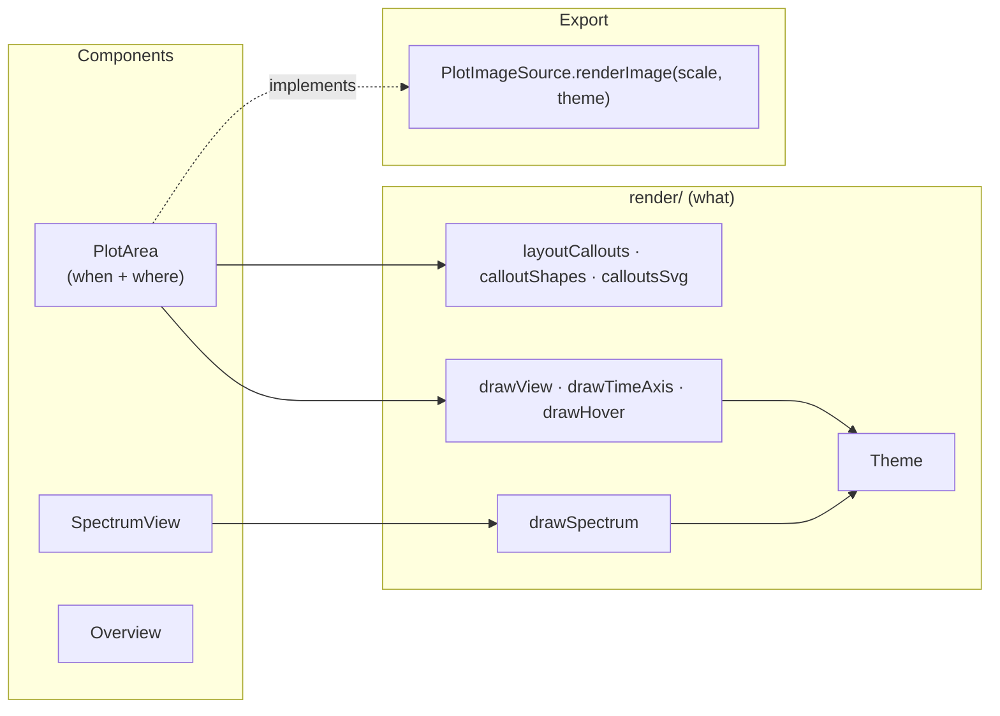
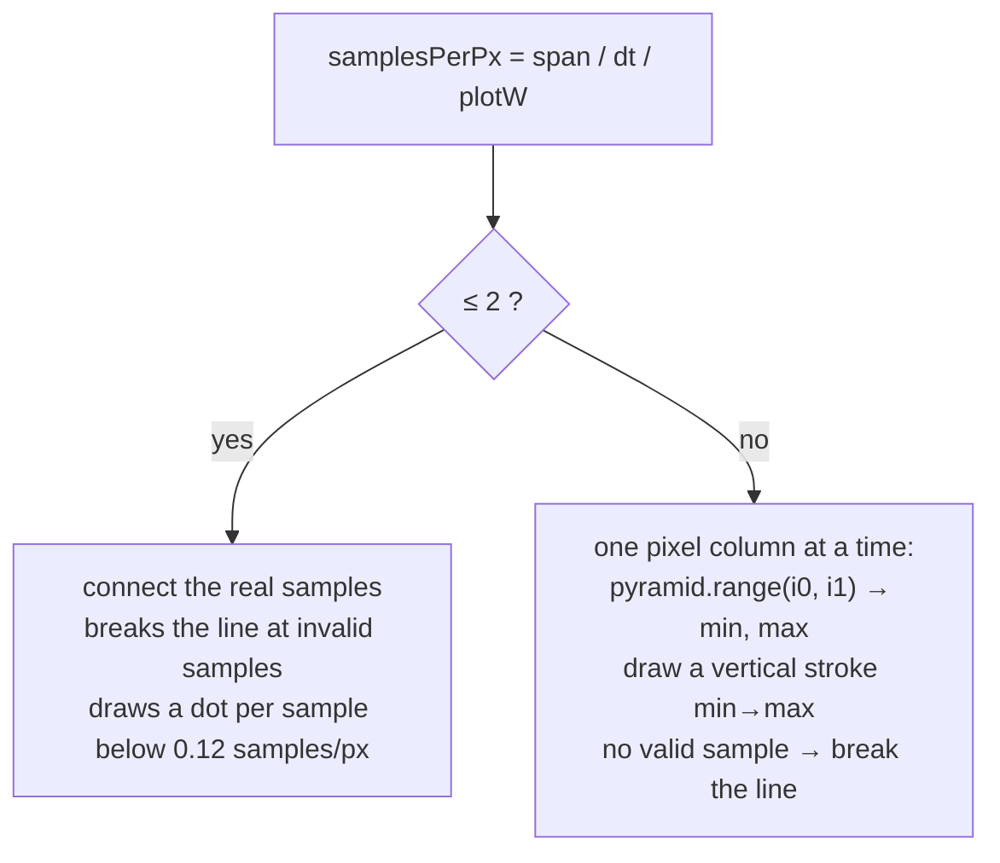
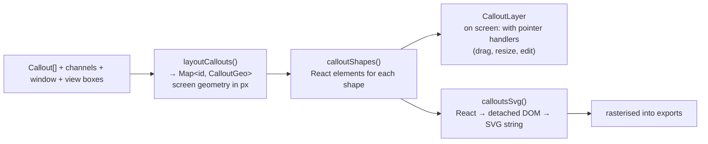
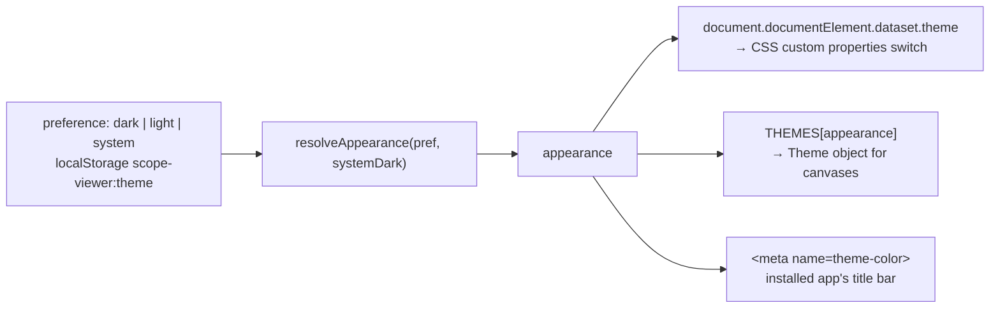

# Rendering

How the plot is drawn: layers, geometry, themes, callouts, TeX. Code: [`src/render/`](../src/render) and
[`src/components/PlotArea.tsx`](../src/components/PlotArea.tsx).

## 1. The idea

Drawing is split into **pure functions that take a context and options** (in `render/`) and
**components that decide when to call them** (in `components/`). The drawing functions know nothing
about React state, which is why the same code serves the screen *and* the exports.



## 2. The layers of the plot

A plot is a stack of elements positioned over each other inside one container:

```
┌─────────────────────────────────────────────────────────────┐
│  per view:  <canvas>   grid, traces, scale labels, tags,      │  drawView()
│             <canvas>   overlay: pointer line, drag previews   │  drawHover(), drag previews
│  one for all views: <svg> callouts (notes, markers, regions…) │  CalloutLayer
│  <canvas> time axis below the views                           │  drawTimeAxis()
└─────────────────────────────────────────────────────────────┘
```

Why this split:

- The **main canvas** of a view is expensive (up to millions of samples) and is redrawn only when
  *what is shown* changes: channels, window, cursors, selection, size, theme.
- The **overlay canvas** is cheap and redrawn on every pointer move: the vertical pointer line with value
  dots, the rubber band of a zoom, a dragged channel tag, a new span. Moving the mouse never repaints traces.
- **Callouts are SVG** because they need hit-testing (drag, resize, right-click), crisp text and
  vector export.

### When the main canvas is redrawn

`PlotArea` uses a `useLayoutEffect` keyed on the things that change the picture. Two modes:

1. **Size changed** (container resize, splitter drag): draw **immediately**, before the browser paints. Resizing a canvas clears it, and drawing one frame later would flash blank.
2. **Otherwise:** draw in `requestAnimationFrame` (coalescing several state changes into one paint), and
   cancel the pending frame in the cleanup.

The container size comes from a `ResizeObserver`. All drawing is scaled by `devicePixelRatio`
(`ctx.setTransform(dpr, 0, 0, dpr, 0, 0)`) so coordinates stay in CSS pixels.

## 3. Drawing a view – `drawView`

[`render/draw.ts`](../src/render/draw.ts) draws one stacked view in this order:

1. **Background**, then the **graticule**: 10 divisions high; rows at *round values of the axis channel*
   (`gridRows`), so scale labels sit on the rows and the grid moves with that channel's position; columns
   at the time ticks (`timeTicks`, 1-2-5 steps). Dots on every line mark fifths of a division.
2. **Traces** (clipped to the plot area) – `drawTrace`, see below.
3. **Right-hand scale labels** for the *selected* channel of the view (else the first visible), at round
   values at least 15 px apart (`labelStep`; on the 1-2-5 sequence they land on grid rows).
4. **View number chip** when several views are shown (lit where the selected channel is).
5. **Channel tags** on the left edge (`layoutTags`) – the handles of the scope. They are placed at each
   channel's position level; tags that would collide are pushed apart with a short leader line to their
   level; a position outside the view pins the tag to the edge with an arrow.
6. **Trigger**: a marker at time 0, and the level as a dashed line plus an arrow on the right edge in the
   colour of the trigger source, labelled with source and slope (`C4 ↗`). Outside the view the arrow stays at
   the top or bottom edge, pointing towards the level.
7. **Cursors** A (solid) and B (dashed) with their letter labels (on the first view only) and a dot where
   the cursor source's trace crosses them.

### `drawTrace` – two regimes



The second regime is why a 100-million-sample record scrolls smoothly: each device-pixel column costs a
few pyramid lookups. The selected channel is drawn slightly thicker (1.5 px vs 1.1 px).

### Geometry helpers

All pure and unit-tested ([`draw.test.ts`](../src/render/draw.test.ts)):

| Function | Purpose |
| --- | --- |
| `viewBoxes(sizes, count, available, shown)` | tops and heights of the stacked views from their shares; hidden views get 0; no shown view is lower than `MIN_VIEW_H` (40 px); whole pixels, no gaps |
| `viewAt(boxes, y)` | which view is at height `y` |
| `valueToDiv`, `divToValue`, `valueAt` | value ↔ division ↔ interpolated sample at a time |
| `gridRows`, `labelStep`, `labelEvery` | graticule rows, scale-label spacing, how many time labels fit |
| `layoutTags`, `tagAt` | channel tag layout and hit-test |
| `textWidth` | text measuring with a shared scratch canvas (an estimate where there is no canvas, i.e. tests) |

## 4. Callouts

Files: [`model/callouts.ts`](../src/model/callouts.ts) (data), [`render/callouts.tsx`](../src/render/callouts.tsx)
(geometry and shapes), [`components/CalloutLayer.tsx`](../src/components/CalloutLayer.tsx) (interaction).



- **Geometry is recomputed from data coordinates on every change** (`layoutCallouts`). It returns a
  `CalloutGeo` per callout – a discriminated union (`NoteGeo`, `MarkerGeo`, `RegionGeo`, `BoxGeo`,
  `SpanGeo`) – containing everything needed to draw and hit-test it.
- **Labels never overlap**: note boxes stay inside the plot, labels of close markers and overlapping
  regions are stacked in rows (`stackRows`), and the cursor readout is moved below the marker flags
  (`flagsBottom`).
- **One set of shapes, two outputs.** `calloutShapes()` returns React elements. On screen they get
  pointer handlers (`PartProps`); for export `calloutsSvg()` renders the same elements into a detached
  `div` with `createRoot` + `flushSync`, serialises the SVG and `PlotArea` rasterises it onto the export
  canvas. Exported callouts therefore look exactly like on-screen ones.
- **Draggable parts** are named (`CalloutPart`): `box`, `anchor`, `marker`, `start`, `end`, `region`,
  `rect`, the eight compass edges/corners of a box, and `dim` (a span's dimension line).
- Values in callout labels (region/box measurements, a note's trace value) come from `calloutValueText`,
  which asks the compute engine for measurements through the slot `callout:<id>` so long spans are measured
  in the worker.

### TeX in callouts

[`render/tex.ts`](../src/render/tex.ts) and [`render/mathjax.ts`](../src/render/mathjax.ts):

- `splitTex(line)` splits a text line into text parts and `$…$` / `$$…$$` formula parts. `\$` is a literal
  dollar; unpaired or empty delimiters stay text.
- MathJax (`@mathjax/src`, ~1.4 MB) is **imported only when a formula is first needed**
  (`engine ??= import('./mathjax')`) and renders to **plain SVG paths** (no fonts needed, so it can be
  rasterised in exports). The rare-glyph tables (~10 MB in ~40 files) are separate chunks
  (`assets/mathjax-fonts/`), loaded by `mathjax.asyncLoad` and excluded from the offline precache.
- `texSvg(tex, display)` is **synchronous**: it returns the rendered SVG from an LRU cache (300 entries),
  or `undefined` while it renders — and starts the rendering. Callers fall back to the formula's source
  text meanwhile, as they do for formulas with errors.
- `useTexVersion()` re-renders components when a formula finishes. Exports call
  `await loadTex(texts)` first, because they cannot wait for a redraw.

## 5. The spectrum plot and the overview

- [`render/spectrum.ts`](../src/render/spectrum.ts) draws the FFT: a frequency axis that is **log or
  linear** (`FreqMap`, `fToX`/`xToF`), a level scale in dB or linear RMS, peak markers. Pure functions
  again; `SpectrumView` owns the interaction (wheel zooms frequency, drag pans, Shift+drag zooms to a
  range, the level scale on the right has its own wheel and drag).
- [`components/Overview.tsx`](../src/components/Overview.tsx) draws the whole record in miniature (using the
  pyramids, so it is fast on any record) with the visible window as a draggable box, and callout ticks along
  the bottom.

## 6. Themes

There are two appearances, **dark** (default) and **light**, plus "follow the system".



- **CSS** ([`styles.css`](../src/styles.css)): tokens (`--bg`, `--text`, `--accent`, …) on `:root`, overridden in
  `:root[data-theme='light']`.
- **Canvases and exports** use a TypeScript `Theme` ([`render/theme.ts`](../src/render/theme.ts)): `DARK_THEME`,
  `LIGHT_THEME`. It has colours for the plot (`bg`, `grid`, `cursor`, …), the export page (`page`, `panel`,
  `text`), callouts (`noteBox`, …) and two functions:
  - `ink(color)` – a channel/callout colour *as drawn on the plot background*. Identity in dark; in light it
    **darkens pale colours** (yellow CH1, light cyan, green) just enough for a **3:1 contrast** against white
    (`printColor`, WCAG non-text contrast), scaling all channels equally in linear light so hue and
    saturation are kept.
  - `onInk(fill)` – the text colour on a filled badge (channel tags, marker flags): black in the dark
    theme, and in the light theme black or white, whichever has the better contrast with the fill (`textOn`).
- **Why two copies?** Canvases and exports need concrete colour strings in code, and the page needs CSS
  variables. [`themeSync.test.ts`](../src/render/themeSync.test.ts) reads `styles.css` and `index.html` and fails
  if tokens, page colours (`render/pageColors.ts`, which `vite.config.ts` also imports for the PWA manifest)
  or fonts (`render/fonts.ts`) drift apart.
- **Fonts** are shared the same way: `SANS` and `MONO` in `render/fonts.ts` mirror the CSS `font-family`.
- **Exports choose their own appearance** (Dark or Light, independent of the screen): `renderImage(scale,
  theme)` takes the theme as a parameter.

### Avoiding a flash on load

[`public/theme-init.js`](../public/theme-init.js) sets `data-theme='light'` before the stylesheet and React
load, and an inline `<style>` in [`index.html`](../index.html) gives `html` the matching background colour,
so a light-theme user does not see a dark flash. The script is a file of its own because the server's
Content-Security-Policy does not allow inline scripts.

## 7. Rendering for export

`PlotArea` implements `PlotImageSource`:

```ts
renderImage(scale, theme): Promise<HTMLCanvasElement>
```

It creates fresh canvases at `scale ×` the on-screen size, calls the **same** `drawView` for each view
(with the export theme and without hover or drag overlays), draws the time axis, loads TeX for all
callouts, rasterises the callout SVG, and adds the cursor readout. The result goes to
[`composeImage`](../src/export/image.ts), which adds the header, legend and measurement table. See
[Exports](exports.md).
