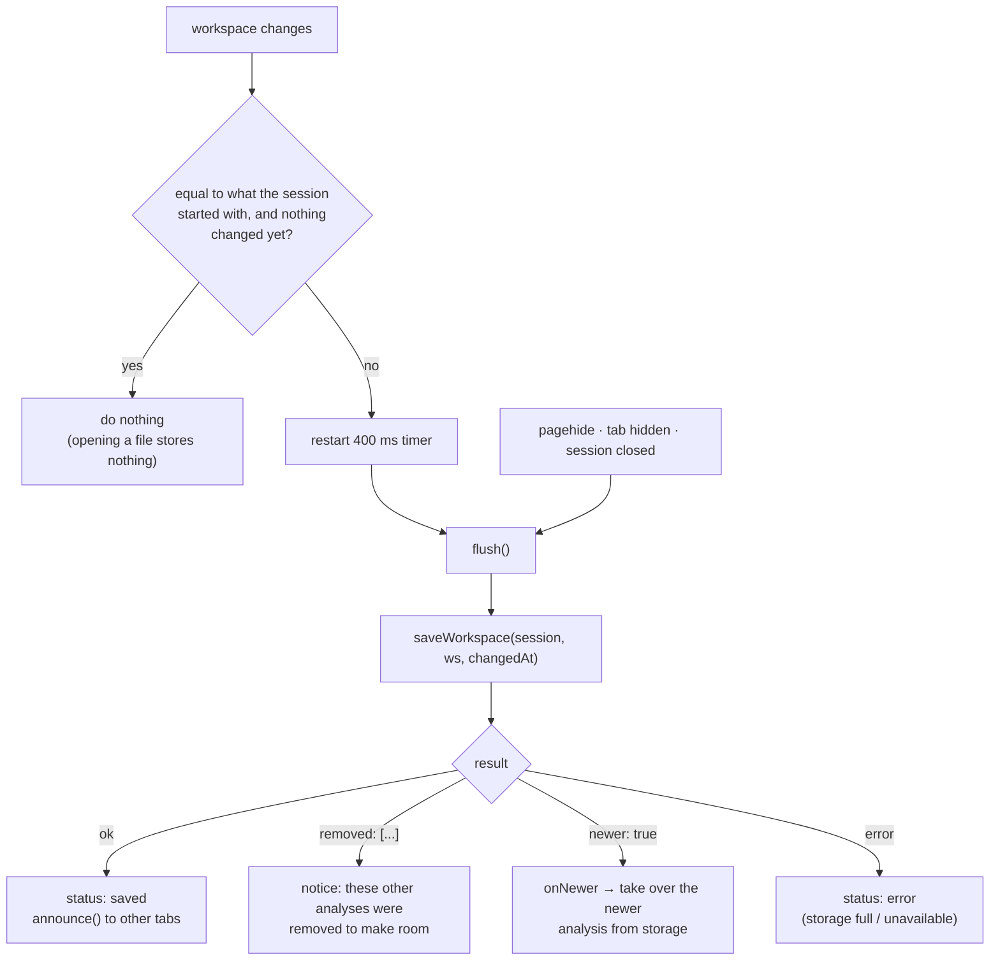

# State and persistence

Where the app's state lives, how it changes, how undo works, and how it is saved and shared between
browser tabs. Code: [`src/components/Scope.tsx`](../src/components/Scope.tsx) and its hooks,
[`src/model/workspace.ts`](../src/model/workspace.ts), [`undoHistory.ts`](../src/model/undoHistory.ts),
[`tabSync.ts`](../src/model/tabSync.ts), [`fileStore.ts`](../src/model/fileStore.ts).

## 1. Four kinds of state

`Scope` (the workspace component) separates state by what it is for. Knowing which kind a piece of
state is tells you whether it can be undone, saved or shared.

| Kind | Examples | Lives in | Undo | Saved | Shared with other tabs |
| --- | --- | --- | --- | --- | --- |
| **Analysis** – the user's work | channel settings, views, math, spectra, callouts, cursors, measurement choice, notes | `doc` (`useState<Analysis>`) | yes | yes (400 ms after a change) | yes |
| **View** – where you are looking | time window, selected channel | `useNavigation`, `useState` | no (use **Back**) | yes (with the workspace) | no |
| **Interaction** | active tool, selected/edited callout, open menus and dialogs, highlighted view | `useState` in `Scope`/components | no | no | no |
| **Layout / preferences** | open panel, overview and table visibility, heights, theme, export options | `usePersistentState` | no | yes, separately (see §2) | no |

Plus two derived/async kinds: **derived** values computed with `useMemo` (`displayById`, `inputChannels`,
`channels`, `viewsShown`) and **computed** results that arrive later from the worker (math channels).

### The analysis document

`Scope` keeps the whole analysis as **one object** and gives every field a setter built by
`fieldSetter(setDoc, 'callouts')` and similar:

```ts
const [doc, setDoc] = useState<Analysis>(() => analysisOf(ws0))
const { math: mathDefs, channels: displays, views, callouts, … } = doc
const setCallouts = fieldSetter(setDoc, 'callouts')   // takes a value or an updater, like setState
```

Two fields change together and have special setters: `setViews` also carries `viewSizes` with it
(`carryViewSizes`: a size follows the channels of its view), and `setMeasKeys/Range/Exclude` update the
nested `measurements` object.

Because the document is a plain immutable JSON-able object, three systems get it for free:

- **undo** compares and stores JSON snapshots,
- **autosave** serialises it,
- **tab sync** sends it.

> **Rule:** anything the user should be able to undo or find again after a reload belongs in `Analysis`.
> Anything that is "where I am looking" or "what I am doing right now" does not.

## 2. What is stored where

| Store | Key / name | Content | Written by |
| --- | --- | --- | --- |
| `localStorage` | `scope-viewer:ws:<fingerprint>` | one session's `Workspace` as JSON | `saveWorkspace` |
| `localStorage` | `scope-viewer:index` | `{ fingerprint → { fileName, savedAt, bytes, changedAt } }` for all saved sessions | `saveWorkspace` |
| `localStorage` | `scope-viewer:layout` | panels, overview, table, spectrum heights, readout | `Scope` via `usePersistentState` |
| `localStorage` | `scope-viewer:theme` | `dark` / `light` / `system` | `ThemeProvider` |
| `localStorage` | `scope-viewer:export` | export dialog options | `ExportDialog` |
| `localStorage` | `scope-viewer:recent-commands` | command palette history | `CommandPalette` |
| `localStorage` | `scope-viewer:keep-files` | `"0"` = do not keep session files | `fileStore` |
| `localStorage` | `scope-viewer:callouts:…`, `:math:…`, `:spectra:…` | **legacy** per-feature stores of older versions | read once by `legacy.ts`, deleted on next save |
| IndexedDB | database `scope-viewer`, store `session-files` | the original session files (`Blob`s) of kept sessions | `keepSessionFiles` |
| `sessionStorage` | `scope-viewer:open-session` | `{ fingerprint, fileName }` of the session open **in this tab** | `App` |
| `BroadcastChannel` | `scope-viewer:workspace` | messages, not storage (see §6) | `tabSync` |
| Cache Storage | Workbox caches | the app shell for offline use | service worker |

All storage access is wrapped in `try/catch`: a browser in private mode, with storage blocked or full,
degrades to "changes are not remembered" (and the save status says so) rather than failing.

`usePersistentState(key, initial)` is `useState` mirrored to `localStorage`; object values are merged
over the initial value so **new fields get their defaults** when an old save is read.

## 3. Undo and redo

Code: [`UndoHistory`](../src/model/undoHistory.ts) (data structure) + [`useUndoHistory`](../src/components/useUndoHistory.ts)
(when to cut steps).

### The data structure

`UndoHistory<T, V>` stores immutable snapshots of the document `T` (`Analysis`) and, optionally, a view
`V` (`TimeWindow`):

- `past` – steps done, each holding the document **before** the step; `future` – steps undone.
- `change(doc)` is called on every change. The first change after a `commit()` **opens a step** (the
  state before it goes on the stack); further changes join that step.
- `commit()` closes the step. A step that ends exactly where it started (compared as JSON – e.g. a drag
  back to the starting point) is removed, so it leaves no empty step.
- Limit: 200 steps. `reset(doc)` clears everything – used when another tab's work is taken over.

### Deciding what is one step

`useUndoHistory` records `doc` after every render and decides *when to commit*:

| Event | Effect |
| --- | --- |
| `pointerdown` | commit the previous step (a new gesture begins) |
| `pointerup` | start the idle timer (the pointer is no longer held) |
| key press outside a text field | commit (ignores repeats and keys during a drag) |
| 700 ms idle with the pointer up | commit |
| `hold = true` | never commit — used while a **new callout** is being created, so adding it *and* typing its text is one step |

Result: a drag, a wheel gesture or a burst of typing is **one undo step**; in text fields the browser's
own undo applies as usual.

### Undo that moves the view

Navigation (zoom, pan) is *not* part of undo – **Back** (Backspace) handles it. One exception: a zoom
that also **rescales channels** (zoom rectangle, zoom-to-box) changes the analysis. That change is an undo
step that must take the window with it, so `moveView(from, to)` attaches the window change to the step;
`undo()` returns `{ doc, view: step.view.from }` and `Scope` calls `nav.show(view)` before applying the
document.

### After an undo

`keepSelectionsIn(analysis)` makes sure nothing stays selected, edited or offered that the restored
analysis no longer has (a selected callout, a deleted math channel's selection, a stale "Undo" notice).
Deletions offer an **Undo notice** (`offerUndo`, 8 s) that is dismissed as soon as another step is
recorded.

## 4. Navigation and "Back"

[`useNavigation`](../src/components/useNavigation.ts) owns the time window.

```ts
const nav = useNavigation(session, ws0.window, displays, setDisplays, onScale)
nav.win         // current { start, end }
nav.navigate(w, 'wheel' | 'pan' | 'zoom')    // continuous: grouped into one Back step
nav.zoomTo(w, patches?, free?)               // discrete; may rescale channels
nav.zoomAt(t, factor)                        // zoom around a time
nav.zoomBack()                               // Backspace
```

- **History:** the last 50 windows. Continuous changes of the same kind within **800 ms** count as one
  Back step, so a wheel gesture is one step back, not hundreds.
- `keepInRecord` clamps panning and zooming to the record unless `free` is set.
- A zoom that scales channels stores the channels' previous vertical settings in the history entry
  (`Verticals`); Back restores them.
- Limits come from `spanLimits(session)` – see [Data model](data-model.md#4-coordinates-and-units).

## 5. Autosave

[`useAutosave`](../src/components/useAutosave.ts) saves `workspaceOf(doc, win, selected)`.



Details:

- **A file that is only opened is not stored.** `boot.source` tells whether the starting workspace came
  from storage, defaults, or a file/migration; autosave compares with the initial JSON and starts only on the
  first real change. An imported or migrated workspace is not in storage yet and is saved right away.
- **Flush on hide.** Timers may be throttled in hidden tabs, so `pagehide` and `visibilitychange → hidden`
  flush immediately.
- **Quota handling.** If `localStorage.setItem` throws a quota error, `saveWorkspace` deletes the *least
  recently saved other session* and retries (up to 100 times), and reports the removed file names so the
  user is told. At most `MAX_STORED_SESSIONS = 50` sessions are kept.
- The stored object is the whole `Workspace` including `window` and `selected`, so reopening restores
  the exact view.

## 6. Several tabs, one session

The same session can be open in several tabs. Rules (see [`tabSync.ts`](../src/model/tabSync.ts)):

- Each analysis has a **`changedAt`** timestamp (ms): when it was last *changed*. The index in
  `localStorage` stores it next to the saved workspace.
- `Scope` keeps a `stamp = { doc, at }` ref. A new `doc` made here gets
  `at = max(Date.now(), previous + 1)`, so versions are strictly ordered even within the same millisecond.
- After every successful save, the tab `announce()`s `{ fingerprint, changedAt, workspace }` on a
  `BroadcastChannel`. A tab does not hear its own messages.
- On news for its session, a tab runs `takeOver(ws, changedAt)`:
  - ignores it if `changedAt <= stamp.at` (it is not newer);
  - if the content is identical, just adopts the timestamp;
  - otherwise sanitises the workspace, sets it as `doc`, **resets the undo history** (the change was not
    made here, so Undo here must not take it back), keeps selections valid, and shows "Updated with the
    changes saved in another tab". The **view stays** (each tab keeps its own zoom).
- `saveWorkspace` **refuses to overwrite a newer analysis** (`index[fp].changedAt > changedAt`) and
  returns `{ ok: false, newer: true }`. This covers the case when the broadcast was missed: the tab then
  loads the stored analysis and takes it over.
- *Reset to file defaults* announces `workspace: null`, which resets all tabs.

## 7. Kept session files and recent sessions

Analyses are small and live in `localStorage`. The **session files** can be hundreds of MB, so they have
their own store in IndexedDB ([`fileStore.ts`](../src/model/fileStore.ts)):

- After a successful open, `keepSessionFiles(fingerprint, name, sources)` stores the file blobs — unless
  they exceed **300 MB**, or keeping is switched off (`keepFilesEnabled`).
- Total budget: **1 GB, capped at 40 % of the browser's storage quota** (`navigator.storage.estimate()`).
  `planEviction` chooses which sessions to drop, **least recently opened first**; if even dropping all
  others cannot fit the new one, it is not kept (`reason: 'not enough browser storage'`).
- Opening an already-kept session only refreshes its `lastOpened`.

[`recent.ts`](../src/model/recent.ts) merges both stores into one list for the start page and the Session
panel: each `RecentSession` has the analysis size (if there is a saved analysis) and the file size (if
the file is kept). A session without its file shows **Locate…**, which asks for the file and then checks
that its fingerprint matches (otherwise: "This is not the stored session … so it was opened on its own").
`forgetSession` removes both.

**Reloading the page** (F5, or *Reload* for a new version): `App` remembers `{fingerprint, fileName}` in
`sessionStorage` (per tab) and reopens the session from the kept files. A new tab or window starts on
the start page.

## 8. Analysis files and reset

- *Save analysis file* → `analysisToJson(session, workspace)` → download `name.scopeview.json`.
- *Open analysis file* (or drop it) → `parseAnalysisJson` → confirm if the fingerprint differs →
  `onReplaceWorkspace({ kind: 'analysis', workspace })` → `App` bumps `generation` → `Scope` remounts
  with `sanitizeWorkspace(workspace, session)`. The pending autosave is cancelled first (`cancelSave`).
- *Reset to file defaults* → confirm → `deleteStoredSession`, announce `null`, remount with
  `{ kind: 'defaults' }`.

Both go through **remounting** instead of mutating a live workspace; there is exactly one code path that
builds the starting state (`initWorkspace`), whatever its source.

## 9. Migration of old data

Earlier versions stored callouts, math channels and spectra under separate keys. `loadWorkspace` checks
the new key first; if absent, `loadLegacy(fingerprint)` reads the old keys and
`sanitizeWorkspace` turns them into a `Workspace` (`source: 'migrated'`). The old keys are removed
on the next save (`LEGACY_PREFIXES`). `legacy.ts` can be deleted once no browser is expected to hold
such data.

The workspace format has a `version` (`WORKSPACE_VERSION = 1`). Files with a *newer* version are
rejected with a clear message; additive changes do not need a bump because `sanitizeWorkspace` fills
anything missing from the file defaults.
