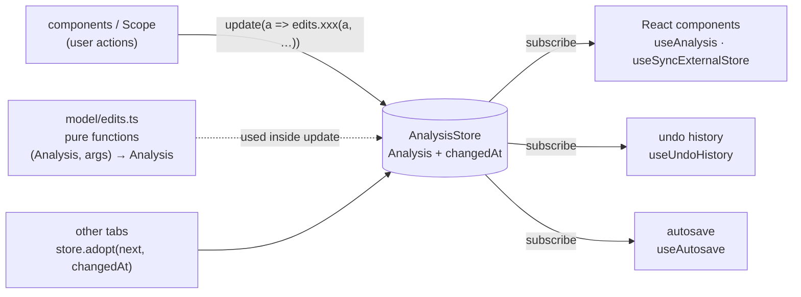
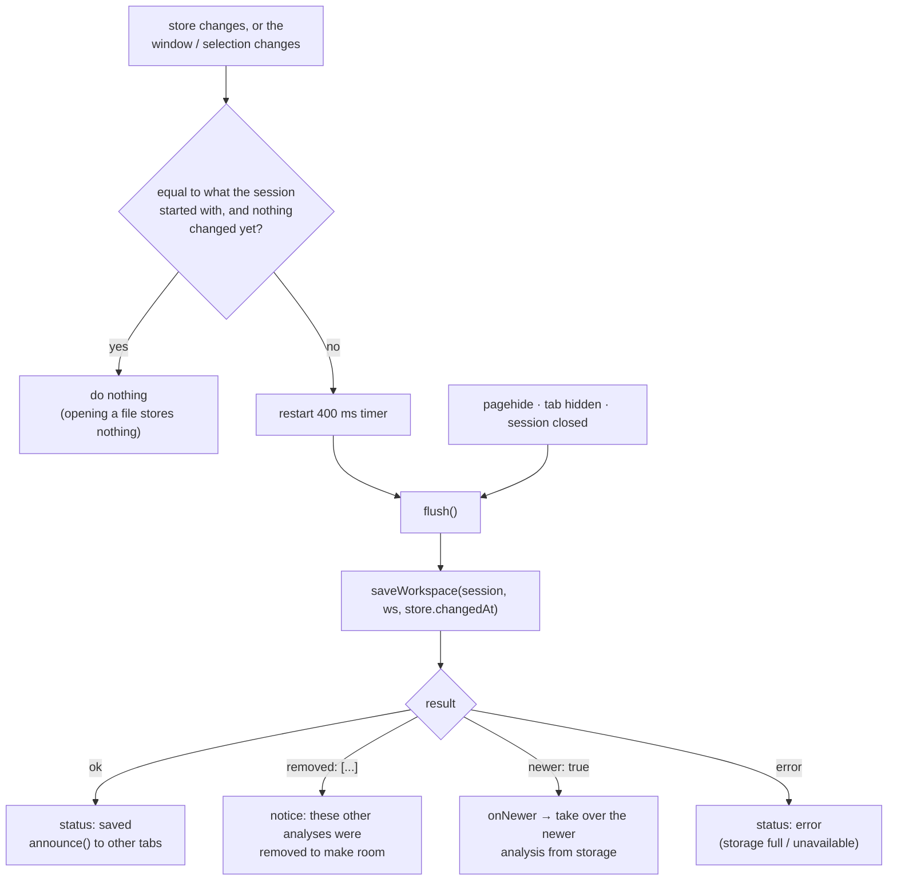

# State and persistence

Where the app's state lives, how it changes, how undo works, and how it is saved and shared between
browser tabs. Code: [`src/model/analysisStore.ts`](../src/model/analysisStore.ts),
[`edits.ts`](../src/model/edits.ts), [`workspace.ts`](../src/model/workspace.ts),
[`undoHistory.ts`](../src/model/undoHistory.ts), [`tabSync.ts`](../src/model/tabSync.ts),
[`fileStore.ts`](../src/model/fileStore.ts), and the hooks in [`src/components/`](../src/components) that connect
them to `Scope.tsx`.

## 1. Four kinds of state

`Scope` (the workspace component) separates state by what it is for. Knowing which kind a piece of
state is tells you whether it can be undone, saved or shared.

| Kind | Examples | Lives in | Undo | Saved | Shared with other tabs |
| --- | --- | --- | --- | --- | --- |
| **Analysis** – the user's work | channel settings, views, math, spectra, callouts, cursors, measurement choice, notes | `AnalysisStore` (not React state) | yes | yes (400 ms after a change) | yes |
| **View** – where you are looking | time window, selected channel | `useNavigation`, `useState` | no (use **Back**) | yes (with the workspace) | no |
| **Interaction** | active tool, selected/edited callout, open menus and dialogs, highlighted view | `useState` in `Scope`/components | no | no | no |
| **Layout / preferences** | open panel, overview and table visibility, heights, theme, export options | `usePersistentState` | no | yes, separately (see §2) | no |

Plus two derived/async kinds: **derived** values computed with `useMemo` (`displayById`, `inputChannels`,
`channels`, `viewsShown`) and **computed** results that arrive later from the worker (math channels).

### The analysis store and its edits

The whole analysis is **one immutable object** in an [`AnalysisStore`](../src/model/analysisStore.ts), a small
class that React does not own:

```ts
const store = new AnalysisStore(analysisOf(workspace), changedAt)
store.get()                       // the current Analysis
store.subscribe(listener)         // called after every change
store.update((a) => edits.addMath(a, ids))   // make a change
```



**What changes the analysis is a function in [`edits.ts`](../src/model/edits.ts).** Each takes the current
`Analysis` and returns the next one, returning the *same* object when nothing changes. They are pure: no React,
no selection, no time window, no notice to show. What an edit needs besides the analysis (the ids of the file's
channels, the visible window, the live channels with their samples) is passed in. The workspace does the UI part
of a change itself, around the edit:

```ts
const removeMath = (id: string) => {
  const attached = calloutsOn(callouts, id)                  // for the message
  offerUndo(`${channelName(id)} deleted …`)
  update((a) => edits.removeMath(a, id, firstId))            // the change to the analysis
  if (selected === id) setSelected(firstId)                  // what the interface does about it
}
```

The edits cover channels (`patchChannel`, `adjustChannel`, `showOnly`, `autoscale`), views (`moveToView`,
`withViews`), math channels (`addMath`, `changeMath`, `removeMath`), callouts (`addCallout`, `updateCallout`,
`deleteCallout`, `duplicateCallout`, `shiftCallout`, `mergeCallouts`), cursors, measurements, spectra and notes.
`edits.test.ts` checks each one, and also that none changes its input (the test analysis is deeply frozen, so an
edit that mutates throws). Two edits change several fields together: `withViews` carries `viewSizes` with the
channels (`carryViewSizes`: a size follows the channels of its view), and `removeMath` removes everything that
refers to the channel (settings, view, spectra, callouts on its trace, measurement choices, cursor source).

Because the document is a plain immutable JSON-able object **in a store**, the systems that follow it need
no help from the components:

- **React components** read it with `useAnalysis()` (`useSyncExternalStore`) and change it with `store.update`;
  `PlotArea` does this itself, through `AnalysisContext`, instead of receiving the fields and setters as props,
- **undo** subscribes and keeps snapshots of the immutable analysis, cut into steps by the `StepGrouper` (see §3),
- **autosave** subscribes and serialises it (see §5),
- **tab sync** is decided by the store (`changedAt`, `adopt`, see §6).

Several `update` calls in a row each see the result of the one before, so there is no stale-closure problem
when a handler changes the analysis twice.

> **Rule:** anything the user should be able to undo or find again after a reload belongs in `Analysis`.
> Anything that is "where I am looking" or "what I am doing right now" does not.

## 2. What is stored where

| Store | Key / name | Content | Written by |
| --- | --- | --- | --- |
| `localStorage` | `scope-viewer:ws:<fingerprint>` | one session's `Workspace` as JSON | `saveWorkspace` |
| `localStorage` | `scope-viewer:index` | `{ fingerprint → { fileName, savedAt, bytes, changedAt } }` for all saved sessions | `saveWorkspace` |
| `localStorage` | `scope-viewer:layout` | panels, overview, table, spectrum heights, readout | `Scope` via `usePersistentState` |
| `localStorage` | `scope-viewer:theme` | `dark` / `light` / `system` | `ThemeProvider` |
| `localStorage` | `scope-viewer:export` | export dialog options | `ExportDialog` |
| `localStorage` | `scope-viewer:recent-commands` | command palette history | `CommandPalette` |
| `localStorage` | `scope-viewer:keep-files` | `"0"` = do not keep session files | `fileStore` |
| `localStorage` | `scope-viewer:callouts:…`, `:math:…`, `:spectra:…` | **legacy** per-feature stores of older versions | read once by `legacy.ts`, deleted on next save |
| IndexedDB | database `scope-viewer`, store `session-files` | the original session files (`Blob`s) of kept sessions | `keepSessionFiles` |
| `sessionStorage` | `scope-viewer:open-session` | `{ fingerprint, fileName }` of the session open **in this tab** | `App` |
| `BroadcastChannel` | `scope-viewer:workspace` | messages, not storage (see §6) | `tabSync` |
| Cache Storage | Workbox caches | the app shell for offline use | service worker |

All storage access is wrapped in `try/catch`: a browser in private mode, with storage blocked or full,
degrades to "changes are not remembered" (and the save status says so) rather than failing.

`usePersistentState(key, initial)` is `useState` mirrored to `localStorage`; object values are merged
over the initial value so **new fields get their defaults** when an old save is read.

## 3. Undo and redo

Code: [`UndoHistory`](../src/model/undoHistory.ts) (data structure), [`StepGrouper`](../src/model/stepGrouping.ts)
(the rules that cut steps, pure and tested) and [`useUndoHistory`](../src/components/useUndoHistory.ts) (passes the
page's events to them).

### The data structure

`UndoHistory<T, V>` stores immutable snapshots of the document `T` (`Analysis`) and, optionally, a view
`V` (`TimeWindow`):

- `past` – steps done, each holding the document **before** the step; `future` – steps undone.
- `change(doc)` is called on every change. The first change after a `commit()` **opens a step** (the
  state before it goes on the stack); further changes join that step.
- `commit()` closes the step. A step that ends exactly where it started (e.g. a drag back to the starting
  point) is removed, so it leaves no empty step. Documents are compared by content with
  [`sameContent`](../src/util/sameContent.ts), which gives the answer JSON would but skips the parts two
  snapshots share – edits keep what they do not change – so a comparison costs about as much as the change.
- Limit: 200 steps. `reset(doc)` clears everything – used when another tab's work is taken over.

### Deciding what is one step

`useUndoHistory` **subscribes to the analysis store**, so a change is recorded the moment it is made (not after the
next render). *When to commit* is decided by a `StepGrouper`, a small class with no DOM and no React: the hook
passes it the page's events (`pointerDown`, `pointerUp`, `keyDown`, `changed`, `setHold`) and it calls `commit`.
The rules:

| Event | Effect |
| --- | --- |
| `pointerdown` | commit the previous step (a new gesture begins) |
| `pointerup` | start the idle timer (the pointer is no longer held) |
| key press outside a text field | commit (ignores repeats and keys during a drag) |
| 700 ms idle with the pointer up | commit |
| `hold = true` | never commit — used while a **new callout** is being created, so adding it *and* typing its text is one step; ending the hold commits |

Result: a drag, a wheel gesture or a burst of typing is **one undo step**; in text fields the browser's
own undo applies as usual. Because the rules are a class of their own, `stepGrouping.test.ts` runs them with
fake timers – the drag, the held key, the callout being typed – which used to be checked only by hand.

### Undo that moves the view

Navigation (zoom, pan) is *not* part of undo – **Back** (Backspace) handles it. One exception: a zoom
that also **rescales channels** (zoom rectangle, zoom-to-box) changes the analysis. That change is an undo
step that must take the window with it, so `moveView(from, to)` attaches the window change to the step;
`undo()` returns `{ doc, view: step.view.from }` and `Scope` calls `nav.show(view)` before putting the
document back with `store.update(doc)`. (Because the history follows the store, it makes no difference whether
`moveView` is called before or after the channels change: it attaches to the open step, or to the step the next
change opens.) The history sees the restored document as a change that equals its base, so it records no step.

### After an undo

`keepSelectionsIn(analysis)` makes sure nothing stays selected, edited or offered that the restored
analysis no longer has (a selected callout, a deleted math channel's selection, a stale "Undo" notice).
Deletions offer an **Undo notice** (`offerUndo`, 8 s) that is dismissed as soon as another step is
recorded.

## 4. Navigation and "Back"

[`useNavigation`](../src/components/useNavigation.ts) owns the time window.

```ts
const nav = useNavigation(session, ws0.window, displays, patchChannels, onScale)
nav.win         // current { start, end }
nav.navigate(w, 'wheel' | 'pan' | 'zoom')    // continuous: grouped into one Back step
nav.zoomTo(w, patches?, free?)               // discrete; may rescale channels
nav.zoomAt(t, factor)                        // zoom around a time
nav.zoomBack()                               // Backspace
```

- **History:** the last 50 windows. Continuous changes of the same kind within **800 ms** count as one
  Back step, so a wheel gesture is one step back, not hundreds.
- `keepInRecord` clamps panning and zooming to the record unless `free` is set.
- A zoom that scales channels stores the channels' previous vertical settings in the history entry
  (`Verticals`); Back restores them. The hook changes channels through the `patchChannels` callback it is
  given (in `Scope`: `store.update((a) => edits.patchChannels(a, patches))`), not through React state.
- Limits come from `spanLimits(session)` – see [Data model](data-model.md#4-coordinates-and-units).

## 5. Autosave

[`useAutosave`](../src/components/useAutosave.ts) saves `workspaceOf(store.get(), window, selected)`. It
**subscribes to the analysis store** for changes of the analysis, and is given the *view* (the time window and the
selected channel, which are not in the store) as an argument; either one schedules a save. The workspace is built at
the moment of saving, from the then-current store and view.



Details:

- **A file that is only opened is not stored.** `boot.source` tells whether the starting workspace came
  from storage, defaults, or a file/migration; autosave compares with the initial JSON and starts only on the
  first real change. An imported or migrated workspace is not in storage yet and is saved right away.
- **Flush on hide.** Timers may be throttled in hidden tabs, so `pagehide` and `visibilitychange → hidden`
  flush immediately.
- **Quota handling.** If `localStorage.setItem` throws a quota error, `saveWorkspace` deletes the *least
  recently saved other session* and retries (up to 100 times), and reports the removed file names so the
  user is told. At most `MAX_STORED_SESSIONS = 50` sessions are kept.
- The stored object is the whole `Workspace` including `window` and `selected`, so reopening restores
  the exact view.

## 6. Several tabs, one session

The same session can be open in several tabs. Rules (see [`tabSync.ts`](../src/model/tabSync.ts)):

- Each analysis has a **`changedAt`** timestamp (ms): when it was last *changed*. The index in
  `localStorage` stores it next to the saved workspace.
- **The `AnalysisStore` keeps it** (`store.changedAt`). Every change made here (`update`) sets
  `changedAt = max(Date.now(), previous + 1)`, so versions are strictly ordered even within the same
  millisecond, and a change made here is always later than a version taken over from another tab.
- After every successful save, the tab `announce()`s `{ fingerprint, changedAt, workspace }` on a
  `BroadcastChannel`. A tab does not hear its own messages.
- On news for its session, a tab runs `takeOver(ws, changedAt)` in `Scope`:
  - ignores it if `changedAt <= store.changedAt` (it is not newer);
  - otherwise sanitises the workspace and offers it to **`store.adopt(next, changedAt)`**, which takes it only
    if the content differs from what is shown (an identical one just moves the timestamp forward) and
    returns whether it did;
  - if it was taken, the tab **resets the undo history** (the change was not made here, so Undo here must not
    take it back), keeps selections valid, and shows "Updated with the changes saved in another tab". The
    **view stays** (each tab keeps its own zoom). Components, undo and autosave learn of the new analysis
    like of any other change, by subscription.
- `saveWorkspace` **refuses to overwrite a newer analysis** (`index[fp].changedAt > changedAt`) and
  returns `{ ok: false, newer: true }`. This covers the case when the broadcast was missed: the tab then
  loads the stored analysis and takes it over.
- *Reset to file defaults* announces `workspace: null`, which resets all tabs.

## 7. Kept session files and recent sessions

Analyses are small and live in `localStorage`. The **session files** can be hundreds of MB, so they have
their own store in IndexedDB ([`fileStore.ts`](../src/model/fileStore.ts)):

- After a successful open, `keepSessionFiles(fingerprint, name, sources)` stores the file blobs — unless
  they exceed **300 MB**, or keeping is switched off (`keepFilesEnabled`).
- Total budget: **1 GB, capped at 40 % of the browser's storage quota** (`navigator.storage.estimate()`).
  `planEviction` chooses which sessions to drop, **least recently opened first**; if even dropping all
  others cannot fit the new one, it is not kept (`reason: 'not enough browser storage'`).
- Opening an already-kept session only refreshes its `lastOpened`.

[`recent.ts`](../src/model/recent.ts) merges both stores into one list for the start page and the Session
panel: each `RecentSession` has the analysis size (if there is a saved analysis) and the file size (if
the file is kept). A session without its file shows **Locate…**, which asks for the file and then checks
that its fingerprint matches (otherwise: "This is not the stored session … so it was opened on its own").
`forgetSession` removes both.

**Reloading the page** (F5, or *Reload* for a new version): `App` remembers `{fingerprint, fileName}` in
`sessionStorage` (per tab) and reopens the session from the kept files. A new tab or window starts on
the start page.

## 8. Analysis files and reset

- *Save analysis file* → `analysisToJson(session, workspace)` → download `name.scopeview.json`.
- *Open analysis file* (or drop it) → `parseAnalysisJson` → confirm if the fingerprint differs →
  `onReplaceWorkspace({ kind: 'analysis', workspace })` → `App` bumps `generation` → `Scope` remounts
  with `sanitizeWorkspace(workspace, session)`. The pending autosave is cancelled first (`cancelSave`).
- *Reset to file defaults* → confirm → `deleteStoredSession`, announce `null`, remount with
  `{ kind: 'defaults' }`.

Both go through **remounting** instead of mutating a live workspace; there is exactly one code path that
builds the starting state (`initWorkspace`), whatever its source.

## 9. Migration of old data

Earlier versions stored callouts, math channels and spectra under separate keys. `loadWorkspace` checks
the new key first; if absent, `loadLegacy(fingerprint)` reads the old keys and
`sanitizeWorkspace` turns them into a `Workspace` (`source: 'migrated'`). The old keys are removed
on the next save (`LEGACY_PREFIXES`). `legacy.ts` can be deleted once no browser is expected to hold
such data.

### The version of the format

The workspace format has a `version` (`WORKSPACE_VERSION = 1`). Three things keep it safe to change:

- **Additive changes need nothing.** `sanitizeWorkspace` fills anything missing from the file defaults and
  ignores what it does not know, so a new field does not break data saved before it.
- **Incompatible changes get a migration step.** When a field is renamed, split or meant differently, raise
  `WORKSPACE_VERSION` and add the function that turns data of the previous version into the new one to
  `WORKSPACE_MIGRATIONS` (key: the version it starts from). `sanitizeWorkspace` first brings the data up to
  date with `upgrade` ([`migrations.ts`](../src/model/migrations.ts)), step by step, without changing what it is
  given; data without a version counts as the first. If a step fails, or one is missing, the data is treated as
  broken and the file defaults are used – the same as for any other bad data. Everything that reads a workspace
  goes through `sanitizeWorkspace` – autosave, analysis files, bundles – so they all get migrated the same way.
  There are no steps yet, because there is only one version; a test requires one for every version that exists.
- **Files from a newer version are refused.** `parseAnalysisJson` rejects an analysis file whose `version`, or
  whose workspace's, is newer than the app knows, with a clear message, rather than reading half of it.

**No field can be forgotten.** `WORKSPACE_FIELDS` ([`workspace.ts`](../src/model/workspace.ts)) lists every field
of `Workspace`, and does not compile without one for each. The round-trip test saves a workspace with every field
set, loads it and compares – so a field `sanitizeWorkspace` does not keep fails a test. (A schema library
would give the shape checks, but not the part that matters here: the values depend on the open session – channel
ids, the record's length – so they are checked by hand either way. The list and the test cover the gap a
library would have closed, without a dependency.)
