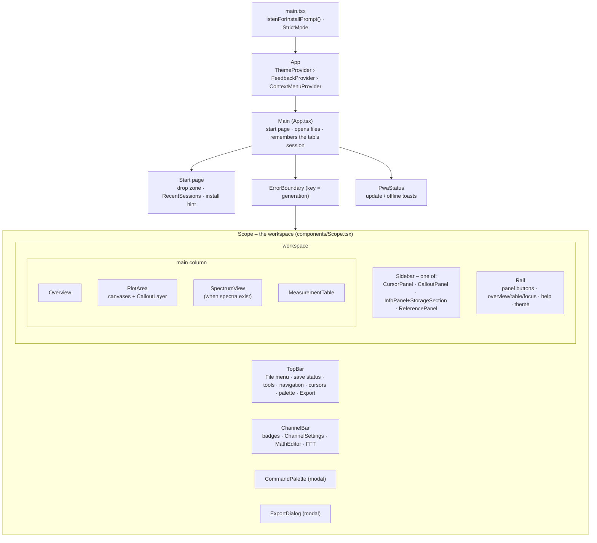
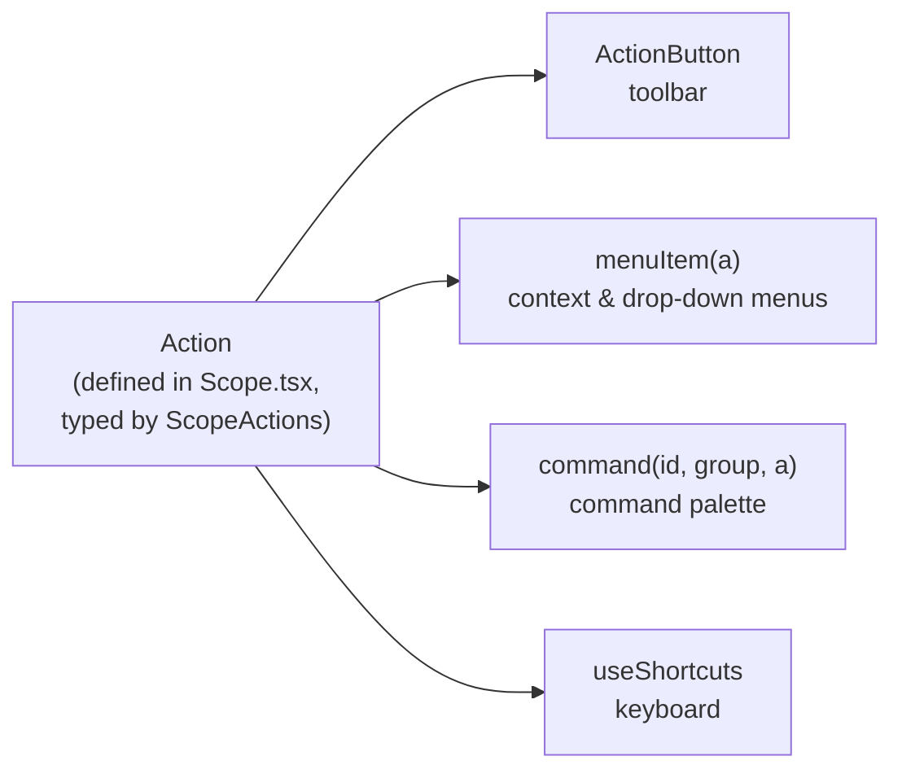

# User interface

How the React UI is organised: the component tree, how a command is defined once and offered in four
places, how the plot handles the mouse, and the small shared UI toolkit. Code:
[`src/App.tsx`](../src/App.tsx) and [`src/components/`](../src/components).

## 1. Component tree



- `App.tsx` is the only place that deals with **files and the start page**; once a session exists, it
  renders `Scope` and passes callbacks (`onOpen`, `onClose`, `onReplaceWorkspace`, `onOpenStored`, …).
- The three providers wrap everything: **theme** (appearance and canvas colours), **feedback** (notices
  and confirm dialogs – `useFeedback()` replaces `alert()`/`confirm()`), and **context menus** (one menu at
  a time; both right-click menus and toolbar drop-downs).
- `ErrorBoundary` catches render errors in the workspace and offers *Open without saved changes* (discard
  the saved analysis of this file and show the file defaults), *Close session*, or *Reload page* — a bug or
  bad saved state never leaves a blank page.

## 2. `Scope` – the workspace

[`Scope.tsx`](../src/components/Scope.tsx) is where state meets UI. In reading order it contains:

1. **Boot** – `initWorkspace(session, initial)` builds the starting workspace.
2. **The analysis store** (`AnalysisStore`, read with `useStoreAnalysis`) and the undo history object. Changes are
   made with `update((a) => edits.xxx(a, …))`.
3. **Layout** (`usePersistentState`), including Focus mode (hide everything, remember what was open).
4. **Channels** – the `ComputeEngine`, `useMathResults`, and the derived lists (`inputChannels`,
   `mathItems`, `channels`, `viewsShown`).
5. **Navigation** – `useNavigation`; `autoscale` (one undo step); math add/change/remove with a *pending
   autoscale* so a new or edited math channel is fitted once its result exists.
6. **Callout operations** – add, update, delete (with Undo notice), edit, jump to, zoom to box, duplicate,
   nudge, step.
7. **Cursors and spectra** operations.
8. **Workspace operations** – undo/redo, tab sync, autosave, save/open analysis and bundle, reset.
9. **Exports** – build an `ExportContext` on demand.
10. **Actions and the `ScopeApi`**, then the keyboard hook, then the JSX.

Most components still get their data **as props** and report changes **as callbacks** (`onAdjust`, `onNavigate`, …),
so each `Props` interface lists exactly what the component reads and may change. `PlotArea`, the one with the
most to do, is different: it follows the analysis store itself through
[`AnalysisContext`](../src/components/analysisContext.ts) (`useAnalysis()` for the views, their sizes, the cursors
and the callouts; `store.update(...)` with an edit for moving a channel, dragging a cursor, resizing views,
editing a callout). Its props shrank from 35 to 22: what remains is the interface state (tool, selection), the
time window (`nav`), and what needs the workspace – menus, and creating a callout, which also selects and opens it.
Everything the interface does *around* a change (select, open an editor, offer Undo) stays in `Scope`; the change
itself is an edit in `model/edits.ts`.

## 3. Actions: one definition, four places

A command like "Autoscale" must look and behave the same in the toolbar, in a menu, in the command
palette and on the keyboard. It is therefore defined **once** as an `Action`
([`ui/action.ts`](../src/components/ui/action.ts)):

```ts
interface Action {
  label: string
  icon?: LucideIcon
  hint?: string          // keyboard shortcut, from keymap.ts
  title?: string         // tooltip
  disabled?: boolean
  checked?: boolean      // a setting that is on
  keepFocus?: boolean    // do not steal focus from a text field
  run: () => void
}
```



- `ScopeActions` (in [`scopeCommands.ts`](../src/components/scopeCommands.ts)) is the **catalogue**: tools,
  undo/redo, back, saved view, full record, autoscale, zoom, cursors, readout, overview, measurements, focus,
  callout stepping, palette, file operations, exports.
- `menuItem(a)` and `command(id, group, a)` adapt an action for a menu or the palette. `command` returns
  `false` for a disabled action, so it simply **drops out of the palette**.
- **Shortcuts** are written once in [`keymap.ts`](../src/components/keymap.ts) (`KEYS`, `TOOLS`, `HELP_ROWS`),
  shown on buttons and in menus, and bound by `useShortcuts`, which maps `KeyboardEvent.key` (lower-cased)
  to an action. Shortcuts are disabled inside inputs, dialogs and menus (`OWN_KEYS`) and while the export
  dialog is open.

### The `ScopeApi`

Menus and the palette need more than actions – they need *data* (channels, callouts, cursors) and
*operations* (select a channel, move it to a view, add a callout). `Scope` builds a `ScopeApi` object on
every render and passes it to the menu builders in `scopeCommands.ts`:

| Builder | Menu |
| --- | --- |
| `fileMenu`, `exportMenu` | top bar drop-downs |
| `plotMenu(api, at: PlotPoint)` | right-click in the plot (what is under the pointer decides the entries) |
| `channelMenu`, `channelItems` | channel badge and tag; the table row reuses `channelItems` |
| `calloutMenu` | a callout in the plot or in the Callouts panel |
| `overviewMenu`, `timebaseMenu` | overview strip, the Horizontal box |
| `rangeChoices` | the screen/cursors/record choice shared by the measurement table and spectrum |
| `paletteCommands(api)` | the command palette: groups *View, Panel, Reference, Edit, Callout, Measurements, Channel, File, Appearance* |

Because menus are built from the *current* API on each use, they are always up to date and need no
subscriptions. A menu entry list may contain `false`/`null`/`''`, which are skipped
(`normalizeMenu` also removes doubled or dangling separators), so conditional entries are written inline.

### The command palette

[`CommandPalette`](../src/components/CommandPalette.tsx) is modal and reads its commands **once** when opened
(`getCommands`). [`searchCommands`](../src/components/ui/commandSearch.ts) ranks results: label starts with the
query → a label word starts with the first query word → other label matches → group/keyword matches;
every query word must appear somewhere; ties go to recently used commands, then list order. With no query it
shows recent commands first. Recent ids are kept in `localStorage` (8 entries). Callouts, channels and
measurements are commands too (`Go to …`, `Hide Ch 2`, `Remove measurement: Rise time`).

## 4. The plot's interaction model

[`PlotArea`](../src/components/PlotArea.tsx) handles every pointer gesture with one state variable, a
discriminated union:

```ts
type Drag =
  | { kind: 'pan' | 'cursor' | 'band' | 'rect' | 'span' | 'region' | 'click' | 'tag' ... }
```

`onPointerDown` decides which drag starts; `onPointerMove` updates it; `onPointerUp` commits it; Esc or a
cancelled pointer calls `cancelDrag`, which **puts everything back** (a moved tag, a dragged cursor, a
pan). Decision order in `onPointerDown`:

1. Right button / Ctrl+click on Mac → context menu (not a drag). Middle button → pan, with any tool.
2. A **channel tag** under the pointer → select the channel and start a `tag` drag (every tool).
3. Near a **cursor** (within 8 px) with the Pan or Zoom tool → drag the cursor.
4. On the **time axis**, or Shift with a navigation tool → `band` (zoom to a time range).
5. Otherwise by tool: Pan → `pan`; Zoom → `rect`; Box → `rect` that becomes a box callout; Region → `region`;
   Span → `span` (needs a trace under the pointer); Note/Marker → `click`.

| Tool | Key | What it does |
| --- | --- | --- |
| Pan | `P` | drag moves the window |
| Zoom | `Z` | drag a rectangle (time + vertical), click zooms in, Alt+click out |
| Note | `N` | click on a trace to attach text |
| Marker | `M` | click: vertical line across all views; snaps to edges |
| Region | `R` | drag a time span; snaps to edges |
| Box | `B` | drag a frame around an event; belongs to the trace through it |
| Span | `D` | drag from a point on one trace to a point on another: the Δt |

Wheel behaviour (`onWheel`, registered non-passive so it can `preventDefault`):

| Pointer on / modifier | Effect |
| --- | --- |
| plot, plain wheel | zoom time around the pointer (`wheelZoomFactor`: proportional, clamped to ×4 per event) |
| Shift+wheel, or a sideways swipe | pan (`wheelPan`, `panShare`: a tenth of the view per 100 px) |
| channel tag, or the scale labels on the right | V/div of that channel, one 1-2-5 step per wheel notch (small trackpad deltas accumulate) |
| Ctrl+wheel | V/div of the selected channel |
| Alt+wheel | position of the selected channel (0.1 div steps) |

**Edge snapping.** For markers, regions, boxes and spans, `PlotArea` builds an *edge finder* per channel
(`edgesOf`): it asks the compute engine for the measurements of the visible range (the same ones the
table uses, via slot `edges:<id>`) to get the 10/50/90 % levels, then `nearestEdge` within 8 px. While a
long range is still being measured, nothing snaps; when the result arrives (`measuredVersion`) the finder
is rebuilt. Alt turns snapping off.

**Selecting a trace** (`nearestTrace`): the visible trace in the view at the pointer whose value at that time
is closest in pixels (within 20 px).

## 5. The other main components

| Component | Role |
| --- | --- |
| **ChannelBar** | One badge per channel, grouped by view with numbers. A click selects the channel and opens its settings popover (`ChannelSettings`); the eye button toggles visibility; right-click opens the channel menu. Drag a badge (mouse or pen; a finger scrolls the row instead) onto a view group or the *New view* box to move it – a press only becomes a drag after the pointer moves 6 px. Hosts **+ Math** (`MathEditor`) and **FFT** buttons. Scrolls horizontally in narrow windows; below 700 px the badges get their own row. |
| **ChannelSettings** | Popover for one channel: label, colour, V/div (typed values like `500m`, `2 V`), position, offset, view, plus the read-only input settings from the scope. |
| **MathEditor** | Expression field with live `checkSyntax` feedback and error position, unit override, quick-operation presets (`MATH_PRESETS`). |
| **MeasurementTable** | Rows = measured channels, columns = chosen measurements. Header click → explanation (`MeasureInfo`/`MeasureFigure`), drag to reorder, *Channels* chooser, range choice, resizable height (`ResizeHandle`). Reads through `useDeferredValue`; keeps old values dimmed while the worker computes. |
| **SpectrumView** | FFT plots with peak list, window choice per spectrum, log/linear axis, dB/linear level, range choice; each spectrum is a worker *slot*. |
| **Overview** | The whole record in miniature, draggable window box, callout ticks. |
| **CalloutLayer / CalloutPanel / CalloutValueEditor** | SVG interaction layer and inline editor; the list panel with search and *Go to*; editor for the measurements shown in a region/box. |
| **CursorPanel** | A/B times, Δt, 1/Δt, per-channel values and Δv. |
| **InfoPanel / StorageSection** | Session facts, screenshot, searchable instrument setup, input settings; save status, notes, save analysis/bundle, reset, list of stored sessions, "keep files" setting. |
| **ReferencePanel** | Documentation of measurements (`MeasureFigure` draws the example pulse train), math functions, spectrum windows (`WindowFigure`) and dB steps. Generated from the same tables the code uses. |
| **ExportDialog** | Chooses the export kind and options; preferences kept in `localStorage`. See [Exports](exports.md). |
| **TopBar / Rail** | Toolbars. The rail also holds the help popover (`HELP_ROWS`) and the theme button. |
| **RecentSessions** | The list of stored sessions on the start page and in the Session panel. |

## 6. Shared UI toolkit – [`components/ui/`](../src/components/ui)

| Module | Provides |
| --- | --- |
| `ContextMenu.tsx`, `Menu.tsx`, `menuContext.ts` | One-at-a-time menus, keyboard-operable (↑ ↓ Enter Esc), items/headings/choice rows; `useContextMenu()`, `useMenus()` |
| `Feedback.tsx`, `feedbackContext.ts` | `notify()` (replaces an older notice of the same kind; errors stay until dismissed) and `confirm()` |
| `ThemeProvider.tsx`, `themeContext.ts` | appearance preference, `useTheme()` with the canvas `Theme` |
| `IconButton.tsx` | `IconButton` and `ActionButton` (renders an `Action`) |
| `ResizeHandle.tsx` | Draggable top edge of the table/spectrum (min 90 px, max 60 % of the window; double-click resets) |
| `useDismiss.ts` | Close a popover on outside press or Esc; Escape is handled after bubbling so a field inside can use it first |
| `placement.ts` | Popover placement that stays inside the window |
| `wheel.ts` | Wheel/trackpad normalisation shared by plot, overview and spectrum |
| `commandSearch.ts` | Palette ranking (pure, tested) |
| `Logo.tsx` | The logo |

## 7. Conventions in component code

- **Imperative handles are rare and explicit**: `PlotAreaHandle` (`size`, `renderImage`),
  `SpectrumViewHandle` (`reveal`, export data), `ChannelBarHandle` (`openSettings`), `ScopeHandle`
  (`importAnalysisFile`), via `forwardRef` + `useImperativeHandle`.
- **Heavy computation never runs in render** without caching: `useMemo`, `useDeferredValue`, `SampleCache`.
- **`useSyncExternalStore`** is used for external, non-React state: the analysis store, the undo history, the
  compute engine's measurement version, TeX renders, the install prompt, the system colour scheme.
- **`eslint-disable react-hooks/exhaustive-deps`** comments appear where an effect deliberately reads
  props through a closure and lists only what should retrigger it; each is explained next to it.
- **Keys cause remounts on purpose**: `Scope` is remounted per session generation; the plot's canvas
  refs are arrays indexed by view.
