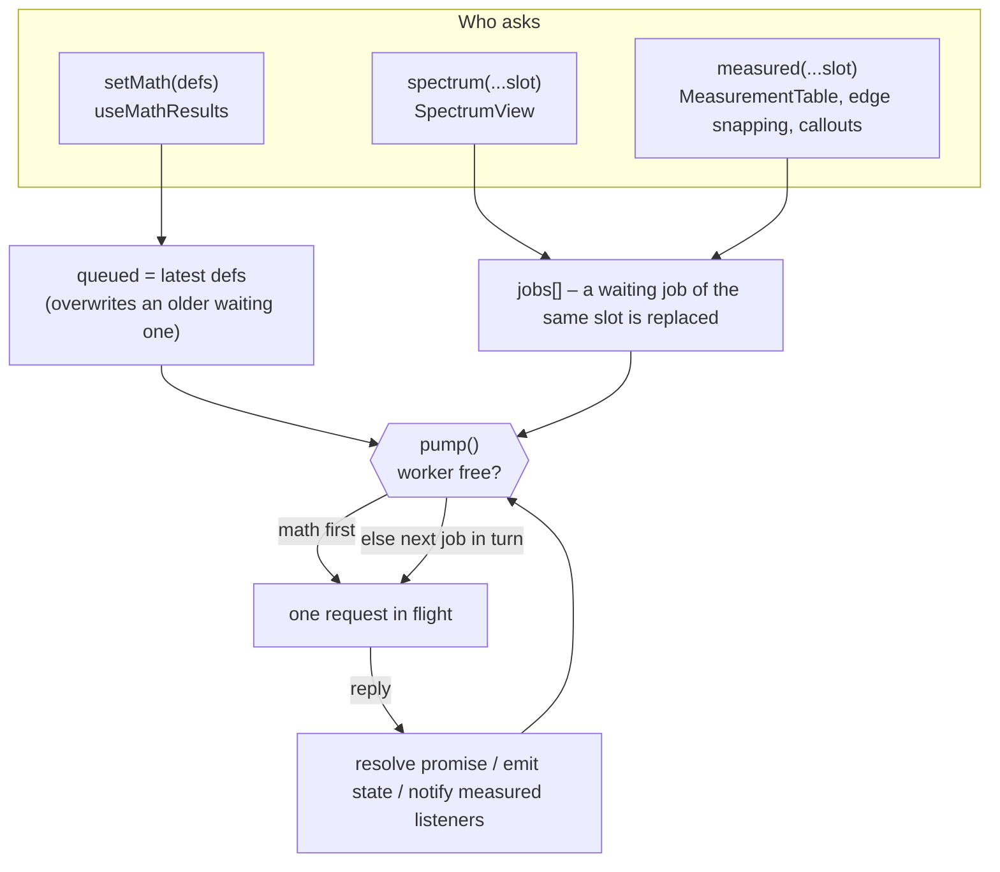
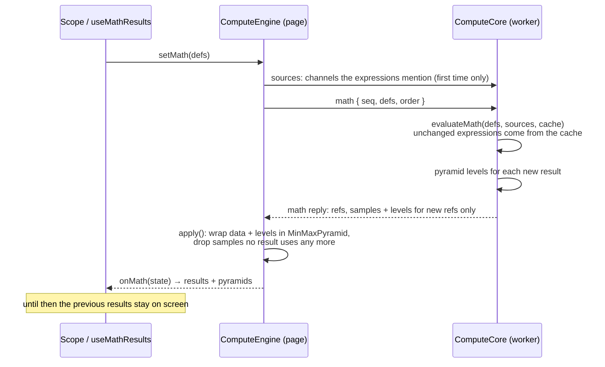

# Workers and compute

How the app stays responsive with records of millions of samples. Code: [`src/compute/`](../src/compute),
[`src/dsp/minmax.ts`](../src/dsp/minmax.ts), [`src/util/sampleCache.ts`](../src/util/sampleCache.ts).

There are two workers. They are unrelated; they just follow the same philosophy.

| | Parse worker | Compute worker |
| --- | --- | --- |
| Code | `parsers/worker.ts` | `compute/worker.ts` → `ComputeCore` |
| Lifetime | One per file opening; terminated as soon as it replies | Started by the first job, lives until the session closes (or it fails) |
| Does | Unpack bundle, hash, parse, build pyramids | Evaluate math channels, compute spectra, measure long ranges |
| Page-side client | `loadSession` in `parsers/load.ts` | `ComputeEngine` in `compute/engine.ts` |
| Protocol | One message in, one message out | Request/reply with sequence numbers (below) |

The parse worker is described in [File loading](file-loading.md). The rest of this page is about the
compute worker.

## 1. The min/max pyramid

A pixel column on screen can cover millions of samples. To draw it you only need the **lowest and
highest** sample inside it. `MinMaxPyramid` precomputes that at several resolutions:

```
level 0 = the samples            (block = 1)
level 1 = min/max of every 16    (block = 16)
level 2 = min/max of every 16²   (block = 256)
level 3 = …                      (block = 4096)
```

`pyramid.range(i0, i1, out)` writes the min and max of samples `[i0, i1)` into `out`:

1. Pick the **coarsest level whose block still fits in the range at least twice**.
2. Fold in the complete blocks of that level.
3. For the partial blocks at both ends, **recurse** into finer levels.
4. If the range is small, scan the raw samples.

So the cost depends on the range's *structure*, not its length – a handful of lookups per pixel column.

Details that matter:

- `FACTOR = 16`; levels are built while the previous level is longer than 64 entries. Memory overhead
  is about 2/15 of the sample data.
- **Invalid samples are skipped** (`NaN`, `±Infinity` – gaps of math channels, division by zero). A block
  without any valid sample stores `NaN`, and the renderer breaks the line there.
- The pyramid is built **in the parse worker** for input channels and **in the compute worker** for
  math results; the page just wraps the received levels (`new MinMaxPyramid(data, levels)`) – no
  recomputation.
- It is used by drawing (`drawTrace`), autoscale (`valueRange`, `traceMiddle`), and the overview strip.

## 2. The compute protocol

Defined in [`compute/protocol.ts`](../src/compute/protocol.ts). Sample arrays are named by a **ref**:

- `"src:CH1"` – the samples of an input channel,
- `"m:3"` – samples that a math channel computed.

Each array crosses the boundary **once**; afterwards both sides know it by its ref.

**Copied or transferred?** Samples that *both* sides keep are copied (structured clone): the input channels
sent with `sources` (the page needs them to draw) and the samples of a math result (the worker keeps them for
spectra and other math channels). Buffers that only the receiver needs are transferred: the pyramid levels of
a math result, and the `rms` array of a spectrum. The price of this design is that a long record used with
math, spectra or long measurements is held in memory twice (once on the page, once in the compute worker).

| Request (page → worker) | Meaning | Reply |
| --- | --- | --- |
| `sources { waves }` | Send input channels the worker will need. No `seq`, no reply. | – |
| `math { seq, defs, order }` | Evaluate all math definitions. `order` = the input channel ids in session order (decides the default time base). | `math { seq, results: MathOutput[] }` |
| `spectrum { seq, ref, dt, i0, i1, window }` | FFT of samples `[i0, i1)` of a ref | `spectrum { seq, spec?, stale? }` |
| `measure { seq, ref, t0, dt, i0, i1 }` | Measurements of a range | `measure { seq, m?, stale? }` |
| – | – | `error { seq, message }` if a request threw |

Replies:

- `spec` is missing when the range has **fewer than 16 samples** (nothing to compute).
- `stale: true` means the referenced array is gone: the math result was replaced by a newer
  evaluation, or the input channel was never sent. The page treats this like "not computed".
- A `MathOutput` carries either an `error` (with a position in the expression) or a `wave` description
  `{ ref, t0, dt, yUnit }`. **Only the first time a ref is sent** does it also carry `data` (the samples)
  and `levels` (the pyramid, whose buffers are *transferred*). Unchanged results are not re-sent.
- A result that reuses an input channel's samples unchanged – the expression `CH1` itself, or
  `delay(CH1, 15n)`, where only `t0` differs – is reported as a `src:` ref without data; the page already
  has those samples.

### `ComputeCore` – the worker's brain

[`compute/core.ts`](../src/compute/core.ts) is the worker logic *without* the worker: a class with a
`handle(request)` method that returns `{ reply, transfer }`. `worker.ts` is a six-line shell around it.
Splitting it this way lets tests run it in-process.

It keeps: the input channels it was sent (`sources`), a `MathCache` so unchanged math expressions are
not recomputed, and the samples of the *current* math results by ref (`math`). After each evaluation
the old samples are dropped – on the worker and on the page alike (`ComputeEngine.apply` does the same),
so memory does not grow as the user edits an expression.

## 3. `ComputeEngine` – the page's side

[`compute/engine.ts`](../src/compute/engine.ts) is a scheduler. Its rules are what make panning
smooth:



1. **One request in flight** (`busy`). The worker is never flooded.
2. **Math first.** Only the latest set of definitions waits (`queued`); intermediate edits are skipped.
3. **Slots.** Spectra and measurements pass a `slot` string naming *who is asking* (`"table:CH1"`,
   `"spectrum:FFT2"`, `"edges:CH1"`, `"callout:<id>"`). If a job for that slot is still waiting, the new
   one **replaces** it (and keeps its place in line). While panning, a consumer therefore has at most
   one request waiting – for the newest range.
4. **Lazy start.** The worker is created by the first job. A session with no math channels, no
   spectra and only short measurements never starts one. `setMath([])` with no worker emits an empty
   state without creating one.
5. **Sources on demand.** `sourcesOf(defs)` parses the expressions to find which input channels they
   mention and sends only those (a constant or `t` takes the first channel's time base, so that one is
   sent). A spectrum or measurement of an input channel sends it the first time.
6. **Failure recovery.** If the worker throws (e.g. out of memory), everything waiting fails with a
   message, math channels show "The computation stopped: …", and the next job starts a fresh worker.
7. **`stop()`** is called when the workspace unmounts. It terminates the worker, forgets refs, and
   resolves every pending job with `null`.

### Measurements: page or worker?

`engine.measured(wave, i0, i1, slot)` returns `Measurements | undefined`:

- **Up to `PAGE_MEASURE_MAX` = 50,000 samples** – measured *immediately on the page* (well under a
  millisecond) and returned.
- **Longer** – sent to the worker; `undefined` is returned until the result arrives. Callers
  subscribe with `useSyncExternalStore(engine.subscribeMeasured, engine.measuredVersion)`: the version
  number increments whenever a result arrives, which makes components ask again.

Results are remembered in a `SampleCache` keyed by the **sample array** (a `WeakMap`) and a key
`t0:dt:i0:i1`. Consequences: changing a channel's colour, label or unit creates new channel *objects* but
the same sample arrays, so **nothing is measured again**; and the measurement table, edge snapping and
callout values share results when they ask for the same range.

`SampleCache(perArray)` keeps the `perArray` most recently used keys per array **plus the last key each
slot asked for**, so one busy consumer cannot evict another's result.

### Consumers show stale values while waiting

`MeasurementTable` and `SpectrumView` keep the previous value (the table dims it, `pending`) until the new
one arrives, so panning does not flicker. They also read the window through `useDeferredValue`, so the
plot itself stays at full frame rate while measurements follow a moment later.

## 4. A math evaluation, step by step



The page-side hook is two lines ([`useMathResults.ts`](../src/components/useMathResults.ts)): subscribe
with `engine.onMath(setState)` and call `engine.setMath(defs)` whenever the definitions change.

## 5. Testing seam

`ComputeEngine`'s constructor takes a worker factory typed as `WorkerLike` (`postMessage`, `onmessage`,
`onerror`, `terminate`). Tests ([`engine.test.ts`](../src/compute/engine.test.ts)) pass a fake that runs
`ComputeCore` synchronously in the same thread, so the whole scheduling logic – ordering, slot
replacement, stale replies, restart after failure – is tested without a browser.
